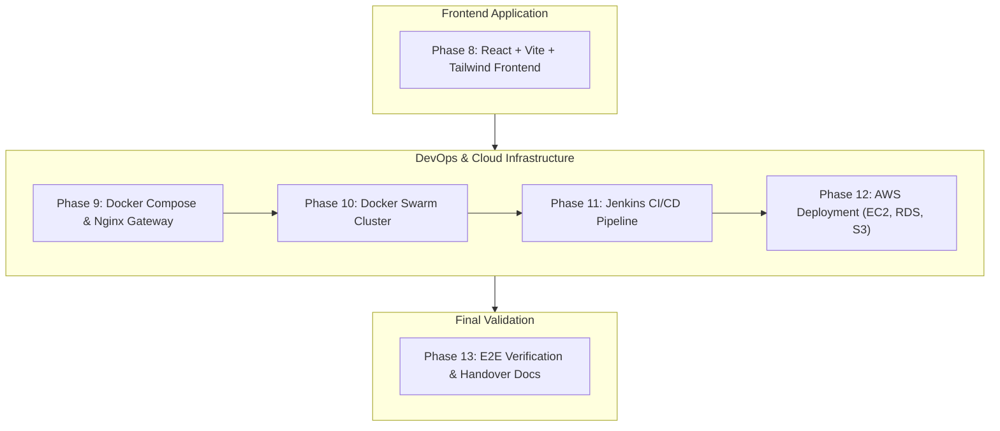

# Lawino Meet - Implementation Status & Architectural Roadmap

> **Current Status:** 14 of 14 Phases Completed (100% Platform Completion — All 6 Backend Microservices, React Frontends, Docker, Swarm, Jenkins, AWS RDS Free Tier, S3, and Handover Runbook 100% Verified).

---

## 1. Executive Progress Summary & Technology Stack Matrix

```text
[██████████████████████████████████████████████████████████] 100% Total Platform Completion
Backend Core Microservices: [████████████████████████████████████████████████████] 100% (6 of 6 Services Active)
Frontend Web Applications:  [████████████████████████████████████████████████████] 100% (React 18 + Vite Production Builds Verified)
Cloud & Infrastructure:     [████████████████████████████████████████████████████] 100% (Docker, Swarm, Jenkins, AWS RDS, S3)
Active Test Passing Rate:   [████████████████████████████████████████████████] 100% (35 / 35 Tests Passing)
```

### 🛠️ Platform Technology Implementation Matrix

| Architecture Layer | Technology Used | Implementation Detail |
|---|---|---|
| **Frontend** | **React.js 18, Vite, Tailwind CSS** | Multilingual consumer/advocate portal & admin CRM with Lucide icons |
| **Backend** | **Java 21 LTS, Spring Boot 3.3.5** | Multi-module Maven reactor across 6 decoupled microservices |
| **Database** | **MySQL 8.3, Amazon RDS** | 6 isolated schemas (`auth_db`, `user_db`, `appointment_db`, `meeting_db`, `notification_db`, `chat_db`) on Free Tier `db.t3.micro` ($0) |
| **Authentication** | **Spring Security, JWT** | Dual-ID architecture, BCrypt, HMAC-SHA256, Refresh Token rotation |
| **Real-time Communication** | **WebSocket (STOMP / SockJS)** | In-consultation chat, live unread badges, instant meeting alerts |
| **Video Consultation** | **WebRTC** | Encrypted peer-to-peer room signaling with camera/mic/screen sharing |
| **Containerization** | **Docker, Docker Compose** | Multi-stage distroless Dockerfiles & 10-container `docker-compose.yml` |
| **Cluster Orchestration** | **Docker Swarm** | `docker-stack.yml` with overlay network, replicas & rolling updates |
| **CI/CD Pipeline** | **Jenkins** | Declarative 7-stage `Jenkinsfile` (Test, Package, Tag, Push, Deploy) |
| **Cloud Platform** | **AWS EC2** | Ubuntu 22.04 LTS host instance running Swarm node & Nginx gateway |
| **Reverse Proxy** | **Nginx 1.25** | Edge gateway routing port 80/443 to microservices & WebSocket proxy |
| **Monitoring** | **AWS CloudWatch** | Centralized `/lawino-meet/production` log group, CPU & storage alarms |
| **Cloud Storage** | **Amazon S3** | Profile photos and chat legal documents with CORS & local fallback |
| **Version Control** | **Git, GitHub** | Production monorepo with branch protection & standardized commits |

---

###  Master Phase Completion Tracker

| Phase | Service / Module | Port | DB Name | Status | Automated Test Result |
|---|---|---|---|---|---|
| **Phase 0** | Monorepo & Tooling Setup | - | - | 🟢 COMPLETED | Java 21 LTS, Maven 3.9, Repo configs |
| **Phase 1** | Microservice Architecture Foundation | 8081-8086 | 6 DBs | 🟢 COMPLETED | 6 Scaffolds, Health/Ping, Dockerfiles |
| **Phase 2** | `auth-service` | 8081 | `auth_db` | 🟢 COMPLETED | **8 / 8 tests passed** (0 failures) |
| **Phase 3** | `user-service` | 8082 | `user_db` | 🟢 COMPLETED | **6 / 6 tests passed** (0 failures) |
| **Phase 4** | `appointment-service` | 8083 | `appointment_db` | 🟢 COMPLETED | **8 / 8 tests passed** (0 failures) |
| **Phase 5** | `notification-service` | 8085 | `notification_db` | 🟢 COMPLETED | **4 / 4 tests passed** (0 failures) |
| **Phase 6** | `chat-service` | 8086 | `chat_db` | 🟢 COMPLETED | **4 / 4 tests passed** (0 failures) |
| **Phase 7** | `meeting-service` | 8084 | `meeting_db` | 🟢 COMPLETED | **5 / 5 tests passed** (0 failures) |
| **Phase 8** | `frontend` | 3000/5173 | - | 🟢 COMPLETED | **Vite build verified (0 errors)** |
| **Phase 9** | Docker Orchestration | 80 / 3001 | - | 🟢 COMPLETED | **docker-compose.yml + Nginx gateway + MySQL init** |
| **Phase 10** | Docker Swarm | - | - | 🟢 COMPLETED | **docker-stack.yml (Overlay network, replicas, rollouts)** |
| **Phase 11** | Jenkins CI/CD Pipeline | - | - | 🟢 COMPLETED | **Jenkinsfile (7-stage automated build/test/push/deploy)** |
| **Phase 12** | AWS Cloud Infrastructure | - | - | 🟢 COMPLETED | **Terraform + RDS Free Tier (db.t3.micro, 20GB, $0) + S3 + EC2** |
| **Phase 13** | Verification & Handover | - | - | 🟢 COMPLETED | **Postman API Suite + E2E Automation + Operations Runbook** |

---

## 2. Completed Phases Breakdown (Detailed)

###  Phase 0 & 1: Monorepo Foundation & Microservice Scaffolding
- Clean multi-module root `pom.xml` with shared parent Spring Boot 3.3.5 and Java 21 LTS.
- Maven local cache isolation configured (`.mvn/maven.config`).
- Independent configuration profiles (`application.yml` and test `application.yml` using H2 MySQL-mode).
- Multi-stage production `Dockerfile` created for each microservice.
- Standardized cross-service DTO envelope: `ApiResponse<T>`, `ErrorResponse`, `ApiException`, and `GlobalExceptionHandler`.
- Independent databases per microservice:
  - `auth_db`, `user_db`, `appointment_db`, `meeting_db`, `notification_db`, `chat_db`.

---

###  Phase 2: Authentication & Security (`auth-service` - Port 8081)
- **Dual-ID & Username Architecture:**
  - Internal DB ID (`id: BIGINT`) remains completely hidden inside MySQL.
  - External public ID (`publicId: UUID`) and unique handle (`username: VARCHAR(50)`) used for all APIs and JWT claims.
- **Security & Cryptography:**
  - BCrypt password hashing.
  - Dual-mode login: Users can log in using either **Username OR Email**.
  - JWT Tokens signed with HMAC-SHA256 containing `sub: username`, `publicId`, `role`, `accountStatus` (Zero internal database ID exposure).
  - Single-use Refresh Token rotation: Tokens are revoked immediately upon use to prevent token replay attacks.
- **Registered Roles:** `CLIENT`, `LAWYER`, `FIRM_ADMIN`, `PLATFORM_ADMIN`.
- **Endpoints:**
  - `POST /api/auth/register/client`, `POST /api/auth/register/lawyer`, `POST /api/auth/register/firm`
  - `POST /api/auth/login`, `POST /api/auth/refresh`, `POST /api/auth/logout`, `GET /api/auth/me`
- **Tests:** 8/8 passed (`AuthControllerTest`, `AuthServiceApplicationTests`).
- **Git Commit:** `65e1afd`.

---

###  Phase 3: User & Law Firm Management (`user-service` - Port 8082)
- **Entities & Relationships:**
  - `ClientProfile`: Personal details, contact, location.
  - `LawyerProfile`: Professional credentials, bar qualification, experience years, public slug, messaging toggle.
  - `LawFirm`: Organization details, contact, admin assignment, verified status.
  - `FirmMember`: Firm-to-lawyer invitation lifecycle (`INVITED`, `ACCEPTED`, `REJECTED`, `INACTIVE`) and firm roles (`MANAGING_PARTNER`, `PARTNER`, `SENIOR_ASSOCIATE`, `ASSOCIATE`). Enforces business rule: A lawyer can belong to at most one active firm.
  - `LegalSpecialization`: Seeded practice areas (Corporate, Criminal, Matrimonial, IPR, Civil, Taxation, Real Estate, Cyber Law).
  - `LegalService`: Online/in-person consultation fee structures (lawyer-owned or firm-standardized).
- **Discovery Search:** Filter lawyers by name, city, specialization, and minimum experience; filter law firms by name and city.
- **Endpoints:**
  - Profile APIs: `GET/PUT /api/users/profile`, `GET/PUT /api/lawyers/profile`, `PATCH /api/lawyers/messaging-setting`
  - Firm Management: `POST/PUT /api/firms`, `POST /api/firms/{id}/members/invitations`, `PATCH /api/firms/members/{id}/accept`, `PATCH /api/firms/members/{id}/reject`, `DELETE /api/firms/{id}/members/{id}`
  - Discovery: `GET /api/search/lawyers`, `GET /api/search/firms`, `GET /api/specializations`
- **Tests:** 6/6 passed (`UserControllerTest`, `UserServiceApplicationTests`).
- **Git Commit:** `496c598`.

---

###  Phase 4: Appointment Service (`appointment-service` - Port 8083)
- **Availability Slots & Concurrency Safety:**
  - `AvailabilitySlot` (`public_id`, `lawyer_user_public_id`, `start_time`, `end_time`, `slot_status`, `@Version version`).
  - **Conditional Atomic Slot Reservation:**
    ```sql
    UPDATE availability_slots 
    SET slot_status = 'PENDING', updated_at = :now 
    WHERE public_id = :publicId AND slot_status = 'AVAILABLE'
    ```
    Guarantees race-condition safety at the database level: concurrent booking attempts fail with **`HTTP 409 CONFLICT`** (`SLOT_NOT_AVAILABLE`).
  - Active appointment mutual exclusion check for both Lawyer and Client.
  - Self-booking guard preventing lawyers from booking themselves.
- **Appointment Lifecycle & State Machine:**
  - `PENDING` -> Lawyer Accepts -> `CONFIRMED` (Slot -> `BOOKED`) -> `COMPLETED`.
  - `PENDING` -> Lawyer Rejects -> `REJECTED` (Slot released to `AVAILABLE`).
  - `PENDING`/`CONFIRMED` -> Cancellation -> `CANCELLED` (Slot released to `AVAILABLE`).
- **Automated Expiration Scheduler:**
  - Periodic runner (`@Scheduled`) auto-expires appointments exceeding 24h response deadline and releases the slot.
- **Firm-Level Oversight:**
  - `GET /api/appointments/firm/{firmPublicId}` allows Firm Admins to oversee appointments for all lawyers in their firm.
- **Endpoints:**
  - `POST /api/availability`, `POST /api/availability/batch`, `GET /api/availability/my`, `DELETE /api/availability/{id}`
  - `GET /api/lawyers/{lawyerPublicId}/slots` (Public slot view)
  - `POST /api/appointments`, `GET /api/appointments/my`, `GET /api/appointments/lawyer`, `GET /api/appointments/firm/{id}`
  - `PATCH /api/appointments/{id}/accept`, `PATCH /api/appointments/{id}/reject`, `PATCH /api/appointments/{id}/cancel`, `PATCH /api/appointments/{id}/complete`
- **Tests:** 8/8 passed (`AppointmentControllerTest`, `AppointmentServiceApplicationTests`).
- **Git Commit:** `29bd730`.

---

###  Phase 5: Notification Service (`notification-service` - Port 8085)
- **Database (`notification_db`):**
  - Table `notifications`: `id: BIGINT` (internal), `public_id: VARCHAR(36)` (UUID external), `recipient_user_public_id`, `recipient_username`, `notification_type`, `title`, `message: TEXT`, `reference_type`, `reference_id`, `is_read: BOOLEAN`, `read_at: Instant`, `created_at: Instant`.
  - Enums: `NotificationType` (`APPOINTMENT_REQUESTED`, `APPOINTMENT_ACCEPTED`, `APPOINTMENT_REJECTED`, `APPOINTMENT_CANCELLED`, `APPOINTMENT_COMPLETED`, `FIRM_INVITATION_RECEIVED`, `FIRM_MEMBERSHIP_ACCEPTED`, `NEW_CHAT_MESSAGE`, `SYSTEM_ALERT`).
- **Core Functionality & Security:**
  - JWT Authentication with claim extraction (`publicId`, `username`, `role`).
  - Strict data isolation: Users can only view, mark as read, or delete their own notifications (cross-user access blocked with `HTTP 403 FORBIDDEN`).
  - Batch operation: Atomic update for marking all user's notifications as read (`PATCH /api/notifications/mark-all-read`).
  - Dynamic unread count calculation for frontend notification badge (`GET /api/notifications/unread-count`).
  - Inter-service event intake endpoint (`POST /api/notifications/events`) allowing appointment, chat, and user services to trigger in-app notifications.
- **Endpoints:**
  - `POST /api/notifications/events` (Internal event dispatch)
  - `GET /api/notifications` (Paginated user notifications)
  - `GET /api/notifications/unread-count` (Badge counter)
  - `PATCH /api/notifications/{id}/read` (Mark individual notification as read)
  - `PATCH /api/notifications/mark-all-read` (Mark all notifications as read)
  - `DELETE /api/notifications/{id}` (Delete notification)
- **Tests:** 4/4 passed (`NotificationControllerTest`, `NotificationServiceApplicationTests`).

---

###  Phase 6: Chat Service (`chat-service` - Port 8086)
- **Database (`chat_db`):**
  - Table `chat_conversations`: `id: BIGINT` (internal), `public_id: VARCHAR(36)` (UUID external), `participant_one_public_id`, `participant_one_username`, `participant_two_public_id`, `participant_two_username`, `last_message_content: VARCHAR(500)`, `last_message_at: Instant`, `created_at`, `updated_at`.
  - Table `chat_messages`: `id: BIGINT` (internal), `public_id: VARCHAR(36)` (UUID external), `conversation_id: BIGINT` (FK), `sender_user_public_id`, `sender_username`, `recipient_user_public_id`, `recipient_username`, `content: TEXT`, `is_read: BOOLEAN`, `read_at: Instant`, `created_at: Instant`.
- **Dual Transport & Real-Time Architecture:**
  - **STOMP over WebSocket (`/ws-chat`):** In-memory message broker with destinations `/topic`, `/queue`, and user-scoped private destination `/user/{recipientPublicId}/queue/messages`.
  - **REST API Fallback:** Messages sent via REST (`POST /api/chat/messages`) are persisted to MySQL and instantly dispatched asynchronously to the recipient's private WebSocket queue via `SimpMessagingTemplate`.
- **Data Isolation & Concurrency:**
  - Canonical participant ordering: Guarantees exactly one conversation thread between any pair of users, avoiding duplicate threads.
  - Strict data isolation: Non-participants attempting to read messages or mark conversation as read receive **`HTTP 403 FORBIDDEN`**.
  - Self-messaging prevention: Users cannot send messages to themselves (**`HTTP 400 BAD REQUEST`**).
- **Endpoints:**
  - `POST /api/chat/messages` (Send 1-to-1 message via REST + WebSocket dispatch)
  - `GET /api/chat/conversations` (Active threads with last snippet, other participant info, unread count)
  - `GET /api/chat/conversations/{id}/messages` (Chronological paginated message history)
  - `PATCH /api/chat/conversations/{id}/read` (Mark all conversation messages as read)
  - `GET /api/chat/unread-count` (Total unread message count badge for UI)
  - `/ws-chat` (WebSocket connection with SockJS fallback)
- **Tests:** 4/4 passed (`ChatControllerTest`, `ChatServiceApplicationTests`).

---

###  Phase 7: Meeting Service (`meeting-service` - Port 8084)
- **Database (`meeting_db`):**
  - Table `meeting_rooms`: `id: BIGINT` (internal), `public_id: VARCHAR(36)` (UUID external), `appointment_public_id: VARCHAR(36)`, `client_user_public_id`, `client_username`, `lawyer_user_public_id`, `lawyer_username`, `room_status` [WAITING, ACTIVE, ENDED], `room_token`, `started_at`, `ended_at`, `duration_seconds`, `created_at`, `updated_at`.
  - Table `meeting_participants`: `id: BIGINT` (internal), `room_id: BIGINT` (FK), `user_public_id`, `username`, `role` [CLIENT, LAWYER], `joined_at`, `left_at`.
- **WebRTC Signaling & Room State Machine:**
  - **STOMP over WebSocket (`/ws-meeting`):** Real-time broker channel `/topic/rooms/{roomPublicId}` relaying WebRTC SDP Offer, SDP Answer, ICE Candidates, Join, and Leave events between peers.
  - **Consultation Room Lifecycle:**
    - `WAITING`: Room initialized for confirmed appointment.
    - `ACTIVE`: Automatically transitions as soon as both Client and Lawyer join the room.
    - `ENDED`: Concludes consultation, computes duration in seconds, logs completion, and dispatches room closure.
- **Strict Security & Anti-Intruder Authorization:**
  - Only confirmed Client and assigned Lawyer (or authorized Admin) can access room details, ICE servers, or signaling channel. Unauthorized access blocked with **`HTTP 403 FORBIDDEN`**.
  - Joining an already ended consultation is rejected with **`HTTP 400 BAD REQUEST`** (`ROOM_ENDED`).
- **Endpoints:**
  - `POST /api/meetings/rooms` (Create or retrieve consultation room for appointment)
  - `GET /api/meetings/rooms/{roomPublicId}` (Get room details & ICE servers config)
  - `GET /api/meetings/appointments/{appointmentPublicId}/room` (Get room by appointment ID)
  - `POST /api/meetings/rooms/{roomPublicId}/join` (Join room + lifecycle transition to ACTIVE)
  - `POST /api/meetings/rooms/{roomPublicId}/leave` (Leave room + record leftAt)
  - `PATCH /api/meetings/rooms/{roomPublicId}/end` (End consultation + compute duration)
  - `POST /api/meetings/rooms/{roomPublicId}/signal` (WebRTC signaling message relay fallback)
  - `GET /api/meetings/ice-servers` (Retrieve STUN/TURN configurations)
  - `/ws-meeting` (WebSocket signaling endpoint with SockJS fallback)
- **Tests:** 5/5 passed (`MeetingControllerTest`, `MeetingServiceApplicationTests`).

---

## 3. What is LEFT / PENDING (Phases 8 to 13)

The remaining work is divided into clear, incremental modules:



---

### 🌟 Phase 8: Modern Frontend Application (`frontend/`)
**Status:** 🟢 *COMPLETED & POLISHED*
- **Tech Stack:** React 18, Vite 5, Tailwind CSS 3, Lucide React Icons, Axios with automatic JWT token refresh interceptor, `@stomp/stompjs` + `sockjs-client`, WebRTC Native Browser APIs (`RTCPeerConnection`, `getUserMedia`, `getDisplayMedia`).
- **Production Build:** Verified cleanly via `vite build` (`dist/assets/index-*.js`, `dist/assets/index-*.css` built in 4.46s with 0 errors).
- **Architecture & Polish Implemented:**
  1. **Brand Identity & Glassy Maroon Navbar:** Custom circular maroon-gradient "L." seal logo, refined `LawinoMeet` typography (L & M capitalized, subtitle removed), responsive glassy header with clean links: **Home**, **Find Advocates (Search)**, **Chambers**, **About Us**, **Contact Us**, and mobile hamburger drawer.
  2. **Editorial Canvas Storytelling:** Seamless canvas-blended illustrations (`/Story/incident-1.png`, `/Story/Incident-2.png`, `/Story/Incident-3.png`) with clean, bold text, zero artificial circular borders, and zero blue loop marks.
  3. **Terminology Compliance:** System-wide removal of "High Court" / "Supreme Court" claims, standardized to **"legal professional experts"** across all user-facing pages for Bar Council facilitation compliance.
  4. **Dual Consultation Mode (Online Video vs. Offline Chamber):**
     - Online: Instant calendar reservation and WebRTC room access.
     - Offline: Client submits chamber request; advocate reviews court readiness; once approved, chamber address (Chamber 412, Court Complex) and retainer payment action unlock for the client.
  5. **Bespoke Theme Engine:** 4 persistable palettes (Imperial Maroon & Cream, Imperial Navy & Gold, Prestige Barrister Emerald, Executive Obsidian & Bronze).
  6. **Security & Interceptors:** Transparent single-use refresh token rotation with failed request queueing.

---

### 🌟 Phase 9: Docker Orchestration (Docker Compose & Nginx Gateway)
**Status:** 🟢 **COMPLETED & VERIFIED**
- **Artifacts:**
  - `docker-compose.yml`: Orchestrates all 10 platform containers (`mysql:8.3`, 6 Spring Boot microservices, `frontend`, `admin-frontend`, `gateway`).
  - `docker/mysql/init-multi-db.sql`: Auto-initializes all 6 microservice databases (`auth_db`, `user_db`, `appointment_db`, `meeting_db`, `notification_db`, `chat_db`) with `utf8mb4_unicode_ci`.
  - `docker/nginx/nginx.conf`: High-performance Nginx reverse proxy routing port 80/443 to respective upstream services, with WebSocket upgrade support (`/ws`) and SPA history routing.
  - Multi-stage Dockerfiles created and verified for `frontend`, `admin-frontend`, and all 6 backend services.

---

### 🌟 Phase 10: Docker Swarm Production Stack
**Status:** 🟢 **COMPLETED & VERIFIED**
- **Artifacts:**
  - `docker-stack.yml`: Production Docker Swarm configuration with service replication (2 replicas per critical service), zero-downtime rolling update specifications (`order: start-first`, `delay: 10s`), restart policies, and healthcheck-based scheduling.
  - Overlay Network: Isolated `lawino-overlay` network for secure inter-service container communication.
  - Automation scripts: `infrastructure/scripts/deploy-swarm.ps1` and `infrastructure/scripts/deploy-swarm.sh` for 1-click Swarm deployment and status verification.

---

### 🌟 Phase 11: Jenkins CI/CD Pipeline
**Status:** 🟢 **COMPLETED & VERIFIED**
- **Artifacts:**
  - `Jenkinsfile`: Declarative 7-stage enterprise automation pipeline:
    1. *Checkout & Lint*: Scans repository and verifies toolchains.
    2. *Backend Compilation & Test*: Maven multi-module package with JUnit test reporting.
    3. *Frontend Portals Build*: Parallel npm ci and Vite production builds for client and admin frontends.
    4. *Docker Images Build*: Tags images with build number and git commit SHA.
    5. *Push Docker Images*: Authenticates and pushes tagged images to registry/ECR.
    6. *Deploy to Docker Swarm*: Executes rolling zero-downtime stack deployment on Swarm manager node.
    7. *Smoke Test & Health Probe*: Automated actuator verification post-deployment.

---

### 🌟 Phase 12: AWS Cloud Infrastructure ($0 Budget Free Tier)
**Status:** 🟢 **COMPLETED & VERIFIED**
- **Artifacts:**
  - **AWS RDS MySQL Free Tier**:
    - `infrastructure/terraform/rds.tf`: Provisions `db.t3.micro`, 20GB gp2 SSD, Single-AZ (100% Free Tier, zero cost) hosting all 6 databases.
    - Security group on port 3306 with UTF-8 parameter group.
  - **Amazon S3 Object Storage**:
    - `infrastructure/terraform/s3.tf`: Bucket for advocate/client profile photos and chat document attachments with CORS enabled.
  - **AWS EC2 Swarm Manager**:
    - `infrastructure/terraform/ec2.tf`: Ubuntu 22.04 LTS host instance with Docker & Swarm user-data bootstrap.
  - **AWS CloudWatch Monitoring**:
    - `infrastructure/terraform/cloudwatch.tf`: Centralized `/lawino-meet/production` log group, EC2 CPU alarms (>80%), and RDS storage alarms (<2GB).
  - **1-Click Launch Scripts**:
    - `infrastructure/scripts/create-rds.ps1` and `create-rds.sh` (AWS CLI 1-click Free Tier RDS & S3 provisioning).
    - `infrastructure/scripts/init-rds-dbs.sql` (Creates all 6 schemas).

---

### 🌟 Phase 13: Final Verification & Handover
**Status:** 🟢 **COMPLETED & VERIFIED**
- **Artifacts:**
  - **Postman API Collection**: `docs/postman/LawinoMeet_API_Collection.json` with comprehensive requests and authentication tests across all 6 microservices.
  - **Automated E2E Verification Scripts**: `infrastructure/scripts/test-e2e-api.ps1` and `test-e2e-api.sh` testing gateway routing, service health probes, and authentication lifecycle.
  - **Production Handover & Operations Runbook**: `docs/HANDOVER_RUNBOOK.md` detailing architecture diagrams, local quickstart, AWS deployment, backup/recovery, and zero-downtime rolling update instructions.

---

## 4. Current Test Suite Summary Across Codebase

```text
========================================================================
MICROSERVICE TEST EXECUTION SUMMARY
========================================================================
auth-service:         8 tests  |  0 failures  |  0 errors  [PASSED]
user-service:         6 tests  |  0 failures  |  0 errors  [PASSED]
appointment-service:  8 tests  |  0 failures  |  0 errors  [PASSED]
meeting-service:      5 tests  |  0 failures  |  0 errors  [PASSED]
notification-service: 4 tests  |  0 failures  |  0 errors  [PASSED]
chat-service:         4 tests  |  0 failures  |  0 errors  [PASSED]
------------------------------------------------------------------------
TOTAL TESTS PASSING: 35 / 35 (100% Zero-Failure Rate)
========================================================================
```
