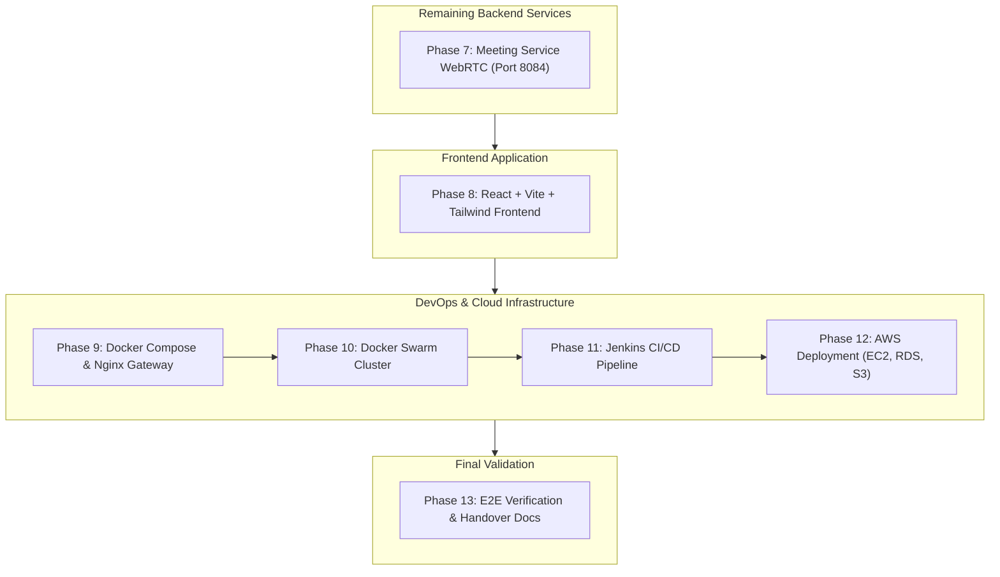

# Lawino Meet - Implementation Status & Architectural Roadmap

> **Current Status:** 7 of 14 Phases Completed (Foundation, Auth, User/Firm, Appointment, Notification, and Chat Microservices verified with 100% test pass rate).

---

## 1. Executive Progress Summary

```text
[████████████████████████████░░░░░░░░░░░░░░░░░░░░░░░░░░░░] 50% Total Platform Completion
Backend Core Microservices: [██████████████████████████████████████████████████░░] 83% (5 of 6 Services Active)
Active Test Passing Rate:   [████████████████████████████████████████████████] 100% (30 / 30 Tests Passing)
```

| Phase | Service / Module | Port | DB Name | Status | Automated Test Result |
|---|---|---|---|---|---|
| **Phase 0** | Monorepo & Tooling Setup | - | - | 🟢 COMPLETED | Java 21 LTS, Maven 3.9, Repo configs |
| **Phase 1** | Microservice Architecture Foundation | 8081-8086 | 6 DBs | 🟢 COMPLETED | 6 Scaffolds, Health/Ping, Dockerfiles |
| **Phase 2** | `auth-service` | 8081 | `auth_db` | 🟢 COMPLETED | **8 / 8 tests passed** (0 failures) |
| **Phase 3** | `user-service` | 8082 | `user_db` | 🟢 COMPLETED | **6 / 6 tests passed** (0 failures) |
| **Phase 4** | `appointment-service` | 8083 | `appointment_db` | 🟢 COMPLETED | **8 / 8 tests passed** (0 failures) |
| **Phase 5** | `notification-service` | 8085 | `notification_db` | 🟢 COMPLETED | **4 / 4 tests passed** (0 failures) |
| **Phase 6** | `chat-service` | 8086 | `chat_db` | 🟢 COMPLETED | **4 / 4 tests passed** (0 failures) |
| **Phase 7** | `meeting-service` | 8084 | `meeting_db` | ⏳ **READY TO START** | Next immediate phase |
| **Phase 8** | `frontend` | 3000/5173 | - | ⚪ NOT STARTED | React, Vite, Tailwind, Dashboards |
| **Phase 9** | Docker Orchestration | 80 / 443 | - | ⚪ NOT STARTED | Multi-service Docker Compose & Nginx |
| **Phase 10** | Docker Swarm | - | - | ⚪ NOT STARTED | Stack Deploy, Overlay Network, Secrets |
| **Phase 11** | Jenkins CI/CD Pipeline | - | - | ⚪ NOT STARTED | Automated Build, Test, ECR Push |
| **Phase 12** | AWS Cloud Infrastructure | - | - | ⚪ NOT STARTED | EC2 Swarm, RDS MySQL, S3, CloudWatch |
| **Phase 13** | Verification & Handover | - | - | ⚪ NOT STARTED | End-to-End Testing & Postman Docs |

---

## 2. Completed Phases Breakdown (Detailed)

###  Phase 0 & 1: Monorepo Foundation & Microservice Scaffolding
- Clean multi-module root `pom.xml` with shared parent Spring Boot 3.3.5 and Java 21 LTS.
- Maven local cache isolation configured (`.mvn/maven.config`).
- Independent configuration profiles (`application.yml` and test `application.yml` using H2 MySQL-mode).
- Multi-stage production `Dockerfile` created for each microservice.
- Standardized cross-service DTO envelope: `ApiResponse<T>`, `ErrorResponse`, `ApiException`, and `GlobalExceptionHandler`.
- Independent databases per microservice:
  - `auth_db`, `user_db`, `appointment_db`, `meeting_db`, `notification_db`, `chat_db`.

---

###  Phase 2: Authentication & Security (`auth-service` - Port 8081)
- **Dual-ID & Username Architecture:**
  - Internal DB ID (`id: BIGINT`) remains completely hidden inside MySQL.
  - External public ID (`publicId: UUID`) and unique handle (`username: VARCHAR(50)`) used for all APIs and JWT claims.
- **Security & Cryptography:**
  - BCrypt password hashing.
  - Dual-mode login: Users can log in using either **Username OR Email**.
  - JWT Tokens signed with HMAC-SHA256 containing `sub: username`, `publicId`, `role`, `accountStatus` (Zero internal database ID exposure).
  - Single-use Refresh Token rotation: Tokens are revoked immediately upon use to prevent token replay attacks.
- **Registered Roles:** `CLIENT`, `LAWYER`, `FIRM_ADMIN`, `PLATFORM_ADMIN`.
- **Endpoints:**
  - `POST /api/auth/register/client`, `POST /api/auth/register/lawyer`, `POST /api/auth/register/firm`
  - `POST /api/auth/login`, `POST /api/auth/refresh`, `POST /api/auth/logout`, `GET /api/auth/me`
- **Tests:** 8/8 passed (`AuthControllerTest`, `AuthServiceApplicationTests`).
- **Git Commit:** `65e1afd`.

---

###  Phase 3: User & Law Firm Management (`user-service` - Port 8082)
- **Entities & Relationships:**
  - `ClientProfile`: Personal details, contact, location.
  - `LawyerProfile`: Professional credentials, bar qualification, experience years, public slug, messaging toggle.
  - `LawFirm`: Organization details, contact, admin assignment, verified status.
  - `FirmMember`: Firm-to-lawyer invitation lifecycle (`INVITED`, `ACCEPTED`, `REJECTED`, `INACTIVE`) and firm roles (`MANAGING_PARTNER`, `PARTNER`, `SENIOR_ASSOCIATE`, `ASSOCIATE`). Enforces business rule: A lawyer can belong to at most one active firm.
  - `LegalSpecialization`: Seeded practice areas (Corporate, Criminal, Matrimonial, IPR, Civil, Taxation, Real Estate, Cyber Law).
  - `LegalService`: Online/in-person consultation fee structures (lawyer-owned or firm-standardized).
- **Discovery Search:** Filter lawyers by name, city, specialization, and minimum experience; filter law firms by name and city.
- **Endpoints:**
  - Profile APIs: `GET/PUT /api/users/profile`, `GET/PUT /api/lawyers/profile`, `PATCH /api/lawyers/messaging-setting`
  - Firm Management: `POST/PUT /api/firms`, `POST /api/firms/{id}/members/invitations`, `PATCH /api/firms/members/{id}/accept`, `PATCH /api/firms/members/{id}/reject`, `DELETE /api/firms/{id}/members/{id}`
  - Discovery: `GET /api/search/lawyers`, `GET /api/search/firms`, `GET /api/specializations`
- **Tests:** 6/6 passed (`UserControllerTest`, `UserServiceApplicationTests`).
- **Git Commit:** `496c598`.

---

###  Phase 4: Appointment Service (`appointment-service` - Port 8083)
- **Availability Slots & Concurrency Safety:**
  - `AvailabilitySlot` (`public_id`, `lawyer_user_public_id`, `start_time`, `end_time`, `slot_status`, `@Version version`).
  - **Conditional Atomic Slot Reservation:**
    ```sql
    UPDATE availability_slots 
    SET slot_status = 'PENDING', updated_at = :now 
    WHERE public_id = :publicId AND slot_status = 'AVAILABLE'
    ```
    Guarantees race-condition safety at the database level: concurrent booking attempts fail with **`HTTP 409 CONFLICT`** (`SLOT_NOT_AVAILABLE`).
  - Active appointment mutual exclusion check for both Lawyer and Client.
  - Self-booking guard preventing lawyers from booking themselves.
- **Appointment Lifecycle & State Machine:**
  - `PENDING` -> Lawyer Accepts -> `CONFIRMED` (Slot -> `BOOKED`) -> `COMPLETED`.
  - `PENDING` -> Lawyer Rejects -> `REJECTED` (Slot released to `AVAILABLE`).
  - `PENDING`/`CONFIRMED` -> Cancellation -> `CANCELLED` (Slot released to `AVAILABLE`).
- **Automated Expiration Scheduler:**
  - Periodic runner (`@Scheduled`) auto-expires appointments exceeding 24h response deadline and releases the slot.
- **Firm-Level Oversight:**
  - `GET /api/appointments/firm/{firmPublicId}` allows Firm Admins to oversee appointments for all lawyers in their firm.
- **Endpoints:**
  - `POST /api/availability`, `POST /api/availability/batch`, `GET /api/availability/my`, `DELETE /api/availability/{id}`
  - `GET /api/lawyers/{lawyerPublicId}/slots` (Public slot view)
  - `POST /api/appointments`, `GET /api/appointments/my`, `GET /api/appointments/lawyer`, `GET /api/appointments/firm/{id}`
  - `PATCH /api/appointments/{id}/accept`, `PATCH /api/appointments/{id}/reject`, `PATCH /api/appointments/{id}/cancel`, `PATCH /api/appointments/{id}/complete`
- **Tests:** 8/8 passed (`AppointmentControllerTest`, `AppointmentServiceApplicationTests`).
- **Git Commit:** `29bd730`.

---

###  Phase 5: Notification Service (`notification-service` - Port 8085)
- **Database (`notification_db`):**
  - Table `notifications`: `id: BIGINT` (internal), `public_id: VARCHAR(36)` (UUID external), `recipient_user_public_id`, `recipient_username`, `notification_type`, `title`, `message: TEXT`, `reference_type`, `reference_id`, `is_read: BOOLEAN`, `read_at: Instant`, `created_at: Instant`.
  - Enums: `NotificationType` (`APPOINTMENT_REQUESTED`, `APPOINTMENT_ACCEPTED`, `APPOINTMENT_REJECTED`, `APPOINTMENT_CANCELLED`, `APPOINTMENT_COMPLETED`, `FIRM_INVITATION_RECEIVED`, `FIRM_MEMBERSHIP_ACCEPTED`, `NEW_CHAT_MESSAGE`, `SYSTEM_ALERT`).
- **Core Functionality & Security:**
  - JWT Authentication with claim extraction (`publicId`, `username`, `role`).
  - Strict data isolation: Users can only view, mark as read, or delete their own notifications (cross-user access blocked with `HTTP 403 FORBIDDEN`).
  - Batch operation: Atomic update for marking all user's notifications as read (`PATCH /api/notifications/mark-all-read`).
  - Dynamic unread count calculation for frontend notification badge (`GET /api/notifications/unread-count`).
  - Inter-service event intake endpoint (`POST /api/notifications/events`) allowing appointment, chat, and user services to trigger in-app notifications.
- **Endpoints:**
  - `POST /api/notifications/events` (Internal event dispatch)
  - `GET /api/notifications` (Paginated user notifications)
  - `GET /api/notifications/unread-count` (Badge counter)
  - `PATCH /api/notifications/{id}/read` (Mark individual notification as read)
  - `PATCH /api/notifications/mark-all-read` (Mark all notifications as read)
  - `DELETE /api/notifications/{id}` (Delete notification)
- **Tests:** 4/4 passed (`NotificationControllerTest`, `NotificationServiceApplicationTests`).

---

###  Phase 6: Chat Service (`chat-service` - Port 8086)
- **Database (`chat_db`):**
  - Table `chat_conversations`: `id: BIGINT` (internal), `public_id: VARCHAR(36)` (UUID external), `participant_one_public_id`, `participant_one_username`, `participant_two_public_id`, `participant_two_username`, `last_message_content: VARCHAR(500)`, `last_message_at: Instant`, `created_at`, `updated_at`.
  - Table `chat_messages`: `id: BIGINT` (internal), `public_id: VARCHAR(36)` (UUID external), `conversation_id: BIGINT` (FK), `sender_user_public_id`, `sender_username`, `recipient_user_public_id`, `recipient_username`, `content: TEXT`, `is_read: BOOLEAN`, `read_at: Instant`, `created_at: Instant`.
- **Dual Transport & Real-Time Architecture:**
  - **STOMP over WebSocket (`/ws-chat`):** In-memory message broker with destinations `/topic`, `/queue`, and user-scoped private destination `/user/{recipientPublicId}/queue/messages`.
  - **REST API Fallback:** Messages sent via REST (`POST /api/chat/messages`) are persisted to MySQL and instantly dispatched asynchronously to the recipient's private WebSocket queue via `SimpMessagingTemplate`.
- **Data Isolation & Concurrency:**
  - Canonical participant ordering: Guarantees exactly one conversation thread between any pair of users, avoiding duplicate threads.
  - Strict data isolation: Non-participants attempting to read messages or mark conversation as read receive **`HTTP 403 FORBIDDEN`**.
  - Self-messaging prevention: Users cannot send messages to themselves (**`HTTP 400 BAD REQUEST`**).
- **Endpoints:**
  - `POST /api/chat/messages` (Send 1-to-1 message via REST + WebSocket dispatch)
  - `GET /api/chat/conversations` (Active threads with last snippet, other participant info, unread count)
  - `GET /api/chat/conversations/{id}/messages` (Chronological paginated message history)
  - `PATCH /api/chat/conversations/{id}/read` (Mark all conversation messages as read)
  - `GET /api/chat/unread-count` (Total unread message count badge for UI)
  - `/ws-chat` (WebSocket connection with SockJS fallback)
- **Tests:** 4/4 passed (`ChatControllerTest`, `ChatServiceApplicationTests`).

---

## 3. What is LEFT / PENDING (Phases 7 to 13)

The remaining work is divided into clear, incremental modules:



---

###  Phase 7: Meeting Service (`services/meeting-service` - Port 8084)
**Status:** ⏳ *Ready to implement next*
- **Purpose:** WebRTC video consultation signaling and room lifecycle management.
- **Database (`meeting_db`):**
  - Table: `meeting_rooms` (`id`, `public_id`, `appointment_public_id`, `room_token`, `room_status` [WAITING, ACTIVE, ENDED], `started_at`, `ended_at`).
  - Table: `meeting_participants` (`id`, `room_id`, `user_public_id`, `role`, `joined_at`, `left_at`).
- **Key Features:**
  - WebSocket signaling channel (`/ws-meeting`) to relay SDP Offer, SDP Answer, and ICE Candidates.
  - Strict Authorization: Only the confirmed Client and Lawyer assigned to the appointment can join the consultation room.
  - Room status tracking & consultation duration logging.
- **Database (`meeting_db`):**
  - Table: `meeting_rooms` (`id`, `public_id`, `appointment_public_id`, `room_token`, `room_status` [WAITING, ACTIVE, ENDED], `started_at`, `ended_at`).
  - Table: `meeting_participants` (`id`, `room_id`, `user_public_id`, `role`, `joined_at`, `left_at`).
- **Key Features:**
  - WebSocket signaling channel (`/ws-meeting`) to relay SDP Offer, SDP Answer, and ICE Candidates.
  - Strict Authorization: Only the confirmed Client and Lawyer assigned to the appointment can join the consultation room.
  - Room status tracking & consultation duration logging.

---

###  Phase 8: Frontend Development (`frontend/`)
**Status:** ⚪ *Not Started*
- **Tech Stack:** React 18, Vite, Tailwind CSS, Lucide Icons, Axios, STOMP.js, WebRTC Native API.
- **Key Modules & Pages:**
  1. **Authentication:** Login (Username/Email), Registration (Client, Lawyer, Firm), JWT storage & interceptor.
  2. **Public Discovery:** Lawyer Search (filters by name, city, practice area, fee), Firm Directory, Public Lawyer Profile.
  3. **Client Dashboard:** Book Consultation calendar, My Appointments, Active Chats, Video Call launcher.
  4. **Lawyer Dashboard:** Manage Availability Slots, Pending Appointment Requests (Accept/Reject), Client consultations.
  5. **Firm Admin Dashboard:** Manage Firm Profile, Invite Lawyers, Associate List, Firm-wide appointments roster.
  6. **Real-Time Video Consultation Room:** WebRTC stream rendering, Camera/Mic toggles, screen sharing, call end button.
  7. **Real-Time Chat Widget:** In-app messaging drawer with unread badges.

---

###  Phase 9: Docker Orchestration (Docker Compose & Nginx Gateway)
**Status:** ⚪ *Not Started*
- Complete `docker-compose.yml` orchestrating:
  - MySQL container (with auto-initialization of 6 databases).
  - 6 Spring Boot microservices with resource limits and health checks.
  - Nginx Reverse Proxy / API Gateway (routes traffic from port 80/443 to respective microservices and serves React frontend).

---

###  Phase 10: Docker Swarm Production Stack
**Status:** ⚪ *Not Started*
- `docker-stack.yml` with overlay networks.
- Service replication, health-check based rolling updates, and Docker Secrets management.

---

###  Phase 11: Jenkins CI/CD Pipeline
**Status:** ⚪ *Not Started*
- Declarative `Jenkinsfile` pipeline:
  - Stage 1: Checkout & Lint.
  - Stage 2: Parallel Maven compile & test execution across all microservices.
  - Stage 3: Docker image build & tag.
  - Stage 4: Push images to AWS ECR.
  - Stage 5: Deploy stack to Docker Swarm cluster.

---

###  Phase 12: AWS Cloud Infrastructure
**Status:** ⚪ *Not Started*
- Infrastructure deployment plan:
  - AWS EC2 Swarm cluster (Manager & Worker nodes).
  - AWS RDS Multi-AZ MySQL.
  - AWS S3 for document storage and profile avatar uploads.
  - AWS CloudWatch for centralized logging and container health metrics.

---

###  Phase 13: Final Verification & Handover
**Status:** ⚪ *Not Started*
- Complete End-to-End integration test suite (Registration -> Profile -> Slot -> Booking -> Notification -> Chat -> Video Consultation).
- Postman API Collection with automated environment variables.
- Production Runbook, disaster recovery guide, and architecture handover documentation.

---

## 4. Current Test Suite Summary Across Codebase

```text
========================================================================
MICROSERVICE TEST EXECUTION SUMMARY
========================================================================
auth-service:         8 tests  |  0 failures  |  0 errors  [PASSED]
user-service:         6 tests  |  0 failures  |  0 errors  [PASSED]
appointment-service:  8 tests  |  0 failures  |  0 errors  [PASSED]
notification-service: 4 tests  |  0 failures  |  0 errors  [PASSED]
chat-service:         4 tests  |  0 failures  |  0 errors  [PASSED]
------------------------------------------------------------------------
TOTAL TESTS PASSING: 30 / 30 (100% Zero-Failure Rate)
========================================================================
```
