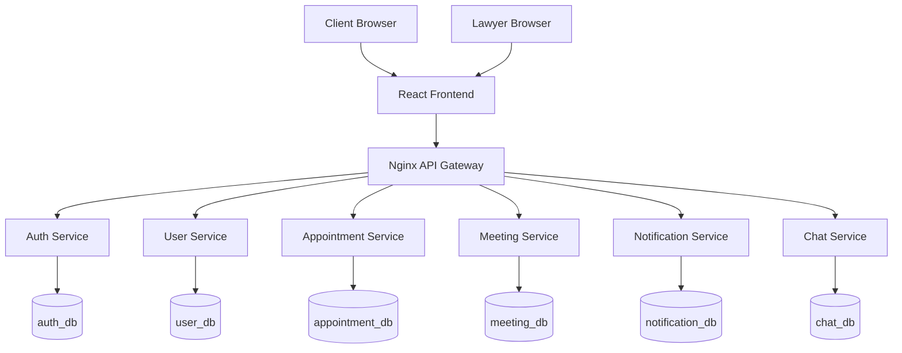
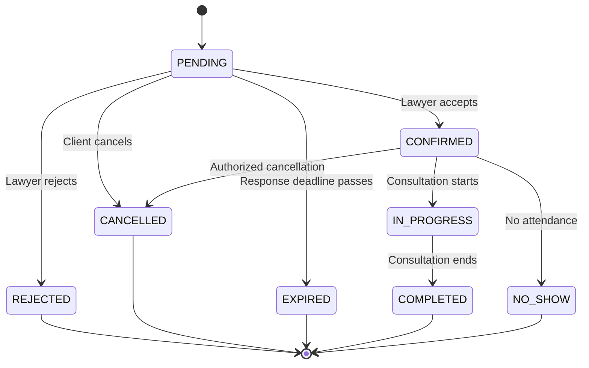
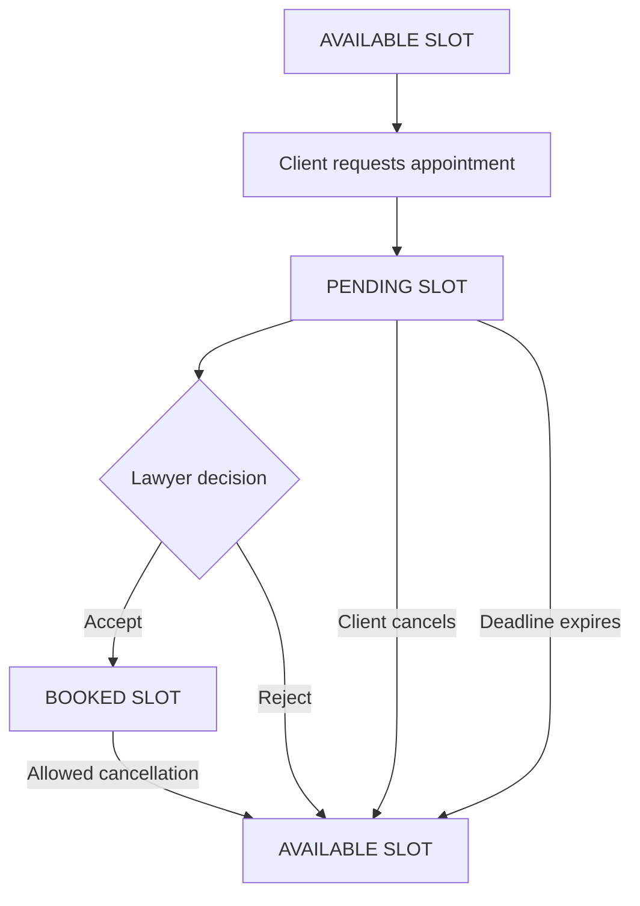
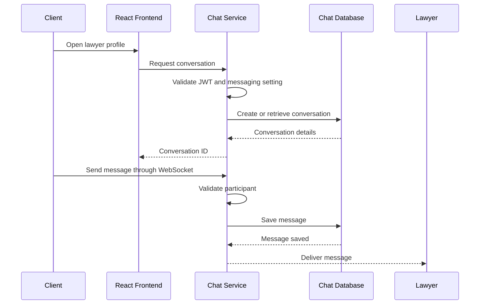
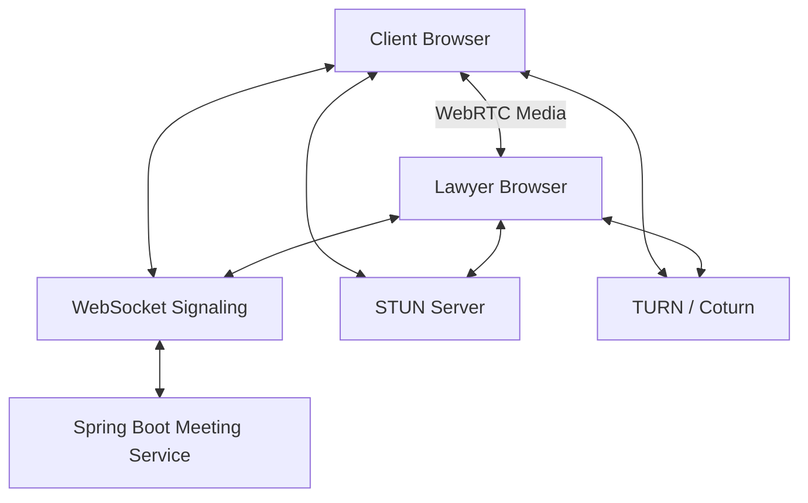
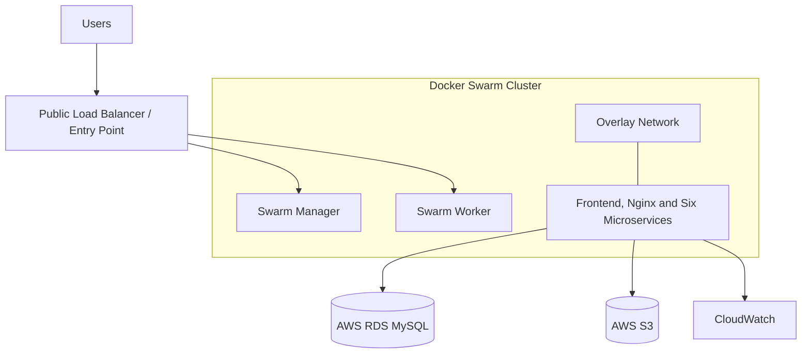
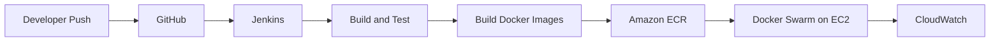

# LAWINO MEET
## Complete Project Specification, System Design & Implementation Plan

**Project Name:** Lawino Meet  
**Project Type:** Legal Professional Discovery, Appointment Scheduling, Chat and Video Consultation Platform  
**Architecture:** Microservices  
**Frontend:** React.js  
**Backend:** Java Spring Boot  
**Database:** MySQL  
**Real-Time Communication:** WebSocket and WebRTC  
**Containerization:** Docker  
**Orchestration:** Docker Swarm  
**CI/CD:** Jenkins  
**Cloud Platform:** AWS  

---

## 🏛️ System Architecture & Subsystem Specification

> **Full Production Specification Document:** [docs/SYSTEM_DESIGN_AND_ARCHITECTURE.md](file:///d:/Lawino-Meet/docs/SYSTEM_DESIGN_AND_ARCHITECTURE.md)  
> The LawinoMeet platform is engineered around **Domain-Driven Design (DDD)** and **Microservices Architecture (SOA)**, organized into **9 Named Enterprise Subsystems**:

### The 9 Core Enterprise Subsystems:
1. **Zero-Trust Identity & Access Authority (`auth-service`)**: Dual-ID JWT token lifecycle management, RBAC enforcement (`ROLE_CLIENT`, `ROLE_LAWYER`, `ROLE_FIRM_ADMIN`, `ROLE_PLATFORM_ADMIN`), BCrypt credentials hashing, and session refresh rotation.
2. **Advocate Registry & Multi-Firm Tenancy Management System (`user-service`)**: Practitioner enrollment auditing, Bar Council credential verification, law firm multi-bench roster management, and practice arrangement enforcement (`INDEPENDENT`, `FIRM_EXCLUSIVE`, `FIRM_AND_INDEPENDENT`).
3. **Legal Consultation Reservation & Slot Concurrency Engine (`appointment-service`)**: Availability calendar scheduling, time-bounded consultation requests, and optimistic locking mechanisms to mathematically prevent concurrent double-booking of lawyer slots.
4. **WebRTC Video Chamber & Ephemeral Media Signaling Engine (`meeting-service`)**: SDP offer/answer exchange, ICE candidate routing, dynamic WebRTC room generation, and consultation access pass enforcement.
5. **Privileged In-Consultation STOMP Real-Time Messaging Broker (`chat-service`)**: WebSocket STOMP messaging engine, active consultation state validation, document exchange, and unread badge counters.
6. **Event-Driven Audit & Escalation Notification Dispatcher (`notification-service`)**: Cross-service operational alerts, escalation events, email notifications, and in-app bell notification feeds.
7. **Reverse Proxy Gateway & Edge Load Balancer (`nginx`)**: SSL termination, edge rate limiting, WebSocket upgrade tunneling (`/ws-chat`, `/ws-meeting`), and path routing across microservices and twin frontend SPAs.
8. **Multi-Database Decoupled Storage Cluster (`MySQL 8.3 / AWS RDS`)**: Database-per-service isolation (`auth_db`, `user_db`, `appointment_db`, `meeting_db`, `chat_db`, `notification_db`) guaranteeing zero cross-domain table joins and complete failure domain isolation.
9. **Container Orchestration & Ingress Overlay Mesh (`Docker Swarm / AWS ECS`)**: Multi-node overlay network (`lawino-overlay`), automatic health check restarts, service replica scaling, and seamless blue-green zero-downtime rolling deployments.

### High-Level Architectural Topology:

```text
                                 [ End-User Traffic / HTTPS (443) ]
                                                │
                                                ▼
                        ┌───────────────────────────────────────────────┐
                        │      Edge API Gateway & Reverse Proxy         │
                        │    (Nginx 1.25 / SSL / Rate-Limiting / WS)    │
                        └───────┬───────────────────────────────┬───────┘
                                │                               │
             ┌──────────────────┴───────────────┐               │
             ▼                                  ▼               ▼
 ┌───────────────────────┐          ┌───────────────────────┐  [ WebSocket Upgrades ]
 │ Client & Lawyer Portal│          │ Platform Master Admin │  ┌────────────────────┐
 │ (React Vite SPA)      │          │ (React Vite Console)  │  │ /ws-chat           │
 │ [Port 3000 / :80]     │          │ [Port 3002 / :80]     │  │ /ws-meeting        │
 └───────────┬───────────┘          └───────────┬───────────┘  └─────────┬──────────┘
             │                                  │                        │
             └──────────────────┬───────────────┴────────────────────────┘
                                │
             ┌──────────────────┼───────────────────────────────┐
             │                  │                               │
             ▼                  ▼                               ▼
 ┌──────────────────────┐ ┌──────────────────────┐ ┌──────────────────────┐
 │  Identity & RBAC     │ │ Advocate Registry &  │ │ Consultation Booking │
 │  Authority           │ │ Multi-Firm Engine    │ │ Concurrency Engine   │
 │  (auth-service:8081) │ │ (user-service:8082)  │ │ (appointment-service)│
 └──────────┬───────────┘ └──────────┬───────────┘ └──────────┬───────────┘
            │                        │                        │
            ▼                        ▼                        ▼
 ┌──────────────────────┐ ┌──────────────────────┐ ┌──────────────────────┐
 │ WebRTC Video Meeting │ │ STOMP Real-Time      │ │ Event-Driven Audit & │
 │ Signaling Engine     │ │ Messaging Broker     │ │ Notification Service │
 │(meeting-service:8084)│ │ (chat-service:8086)  │ │(notification-service)│
 └──────────┬───────────┘ └──────────┬───────────┘ └──────────┬───────────┘
            │                        │                        │
            └────────────────────────┼────────────────────────┘
                                     ▼
                      ┌─────────────────────────────┐
                      │ Decoupled Database Cluster  │
                      │ (MySQL 8.3 / AWS RDS Multi) │
                      │ [auth_db, user_db, appt_db, │
                      │  meet_db, chat_db, notif_db]│
                      └─────────────────────────────┘
```

---

# TABLE OF CONTENTS

1. Project Overview
2. Problem Statement
3. Project Objectives
4. Project Scope
5. User Roles and Permissions
6. Functional Requirements
7. Complete Application Workflow
8. System Architecture
9. Microservices Design
10. Database Architecture
11. Detailed Database Schema
12. Inter-Service Communication
13. Appointment Lifecycle and Business Rules
14. Chat System Design
15. Video Consultation System Design
16. Frontend Architecture
17. API Gateway and Routing
18. Authentication and Security
19. Docker Architecture
20. Docker Compose Configuration
21. Docker Swarm Architecture
22. Jenkins CI/CD Pipeline
23. AWS Infrastructure
24. Monitoring and Logging
25. Error Handling and Reliability
26. Testing Strategy
27. Non-Functional Requirements
28. Repository Structure
29. Development and Implementation Phases
30. Deployment Plan
31. MVP Scope and Future Enhancements
32. Instructions for Antigravity

---

# 1. PROJECT OVERVIEW

Lawino Meet is a web-based legal consultation platform that connects clients with independent lawyers and registered law firms.

The platform allows clients to discover legal professionals based on their location, legal specialization, consultation type and professional experience.

Clients can explore lawyer profiles, view available services and consultation fees, request appointments, communicate through optional real-time messaging and conduct online video consultations.

Lawyers can register independently or become members of registered law firms. Law firms can establish their organizational profiles and manage their associated lawyers.

The appointment system follows a lawyer-approval workflow. An appointment request is not automatically confirmed when submitted. The assigned lawyer must review and accept the request before the appointment becomes confirmed.

The platform will be developed using six independent Spring Boot microservices, with a React frontend and MySQL databases owned separately by each service.

The entire application will be containerized using Docker and deployed through Docker Swarm. Jenkins will automate the build, testing and deployment process, while AWS will provide the cloud infrastructure.

# 2. PROBLEM STATEMENT

Finding an appropriate legal professional can be difficult for individuals who do not have existing legal contacts or knowledge of local legal services.

Clients often need to search through different sources to compare lawyers, understand their specializations, check consultation availability and arrange appointments.

Similarly, independent lawyers and smaller law firms may lack a centralized digital platform to showcase their services and manage online consultations.

Lawino Meet aims to provide a unified platform where clients can discover legal professionals, request consultations and communicate with them through a secure digital environment.

# 3. PROJECT OBJECTIVES

- Build a centralized legal professional discovery platform.
- Support independent lawyers and registered law firms.
- Provide location-based and specialization-based search.
- Allow clients to explore lawyer profiles and consultation services.
- Implement a lawyer-approved appointment booking system.
- Prevent duplicate and overlapping appointments.
- Provide optional one-to-one client-lawyer messaging.
- Implement one-to-one browser-based video consultations.
- Provide secure authentication and role-based access.
- Develop independently deployable microservices.
- Demonstrate Docker containerization and Docker Swarm orchestration.
- Implement Jenkins-based CI/CD.
- Deploy the application on AWS.
- Monitor infrastructure and application health through CloudWatch.

# 4. PROJECT SCOPE

## 4.1 Included in the Initial Project

- Client registration and login.
- Lawyer registration and profile management.
- Law firm registration and profile management.
- Lawyer and firm discovery.
- Search and filtering.
- Legal service management.
- Lawyer availability management.
- Appointment requests.
- Lawyer approval and rejection.
- Appointment notifications.
- Optional client-lawyer chat.
- One-to-one WebRTC video consultations.
- Role-based dashboards.
- Docker and Docker Compose.
- Docker Swarm deployment.
- Jenkins CI/CD.
- AWS EC2, RDS, S3 and CloudWatch.

## 4.2 Excluded from Initial MVP

- Online payment gateway.
- Automatic legal advice or AI lawyer.
- Group video consultations.
- Video recording.
- Court case management.
- Electronic signatures.
- Complex document management.
- Kafka-based event streaming.
- Kubernetes.
- Distributed database infrastructure.

These features can be introduced in future versions.

# 5. USER ROLES AND PERMISSIONS

The application must support four primary roles.

## 5.1 CLIENT

A client is an individual seeking legal consultation.

Permissions:

- Register and log in.
- Manage personal profile.
- Search lawyers and firms.
- Filter professionals by location and specialization.
- View public professional profiles.
- View consultation services and fees.
- View available appointment slots.
- Submit appointment requests.
- View appointment status.
- Cancel appointments according to policy.
- Chat with lawyers who enable messaging.
- Join confirmed video consultations.
- View notifications.
- View appointment history.

## 5.2 LAWYER

A lawyer can register independently or become associated with a law firm.

Permissions:

- Register and log in.
- Create professional profile.
- Update qualifications and experience.
- Add legal specializations.
- Create consultation services.
- Configure consultation fees.
- Manage availability.
- Block unavailable dates.
- Enable or disable optional messaging.
- Receive appointment requests.
- Accept or reject appointment requests.
- View upcoming appointments.
- Cancel appointments according to policy.
- Participate in chat.
- Join video consultations.
- Manage notification preferences.

A lawyer can belong to one law firm at a time in the initial MVP.

## 5.3 FIRM ADMINISTRATOR

A firm administrator manages a registered law firm.

Permissions:

- Register a law firm.
- Create the firm profile.
- Update organization details.
- Add lawyers to the firm.
- Remove or deactivate firm membership.
- Manage firm information.
- Manage firm services.
- View authorized firm-level information.
- Manage firm public visibility.

A firm administrator must not automatically access:

- Private client-lawyer conversations.
- Personal lawyer login credentials.
- Private consultation information.
- Individual lawyer accounts outside the firm's authorization.

## 5.4 PLATFORM ADMINISTRATOR

The platform administrator manages the entire application.

Permissions:

- View platform users.
- Manage clients and lawyers.
- Review lawyer profiles.
- Review firm registrations.
- Approve or suspend profiles.
- Handle reported accounts.
- Manage account status.
- Monitor platform-level activity.

Platform administrator access to private consultation information must follow a defined authorization and audit policy. Administrative access must not be unrestricted by default.

# 6. FUNCTIONAL REQUIREMENTS

## 6.1 Authentication

- Client registration.
- Lawyer registration.
- Firm administrator registration.
- Login and logout.
- JWT access-token authentication.
- Role-based authorization.
- Password hashing.
- Account activation and deactivation.
- Protected routes and endpoints.

## 6.2 Lawyer Discovery

Clients should be able to discover lawyers through:

- Lawyer name.
- City or location.
- Legal specialization.
- Consultation type.
- Consultation fee.
- Experience.
- Availability.

Search results should display:

- Lawyer name.
- Profile image.
- Specialization.
- Experience.
- Location.
- Consultation fee.
- Associated firm, if applicable.
- Messaging availability.

## 6.3 Law Firm Discovery

Clients should be able to:

- Search registered law firms.
- View firm profiles.
- View associated lawyers.
- View firm location.
- View firm services.
- Open individual lawyer profiles.

## 6.4 Lawyer Profile Management

Each lawyer should have:

- Full name.
- Profile image.
- Professional biography.
- Qualifications.
- Years of experience.
- Specializations.
- Location.
- Languages.
- Consultation types.
- Consultation services.
- Fees.
- Availability.
- Messaging preference.
- Associated firm, if applicable.
- Verification status.

## 6.5 Appointment Management

Clients can request appointments with available lawyers.

Lawyers control the final appointment confirmation.

## 6.6 Chat

Messaging is optional and controlled by the lawyer.

## 6.7 Video Consultation

The application supports private one-to-one browser-based video consultations between the client and assigned lawyer.

# 7. COMPLETE APPLICATION WORKFLOW

## 7.1 Client Journey

1. Client searches for legal assistance.
2. Client opens Lawino Meet.
3. Client registers or logs in.
4. Client searches for a legal specialization.
5. Client selects a location.
6. Application displays matching lawyers and firms.
7. Client opens a lawyer profile.
8. Client reviews experience, services and fees.
9. Client views available appointment slots.
10. Client selects a suitable slot.
11. Client submits an appointment request.
12. Appointment status becomes PENDING.
13. Client receives a notification.
14. Lawyer reviews the request.
15. Lawyer accepts or rejects it.
16. Client receives the decision.
17. If accepted, the appointment becomes CONFIRMED.
18. Client can join the video consultation when eligible.
19. Client can optionally chat if the lawyer has enabled messaging.
20. After consultation, appointment becomes COMPLETED.

## 7.2 Independent Lawyer Registration

1. Lawyer selects Register as Lawyer.
2. Lawyer creates an account.
3. Auth Service creates the authentication account.
4. Lawyer completes the professional profile.
5. Lawyer adds specializations and services.
6. Lawyer configures consultation fees.
7. Lawyer sets availability.
8. Lawyer chooses whether to enable messaging.
9. Lawyer submits the profile.
10. Platform administrator reviews the profile if verification is required.
11. Approved profile becomes publicly discoverable.

## 7.3 Law Firm Registration

1. User selects Register as Law Firm.
2. User creates the firm administrator account.
3. Firm details are submitted.
4. User Service creates the organization profile.
5. Firm administrator adds associated lawyers.
6. Lawyers receive membership invitations.
7. Lawyers accept membership invitations.
8. Firm profile displays associated lawyers.
9. Firm administrator manages authorized organizational information.

A lawyer must explicitly accept a firm membership invitation before becoming associated with that firm.

# 8. SYSTEM ARCHITECTURE

The application must use a microservices architecture.

It will contain:

- One React frontend.
- One Nginx reverse proxy/API gateway.
- Six independent Spring Boot microservices.
- Six logically separate MySQL databases.
- Docker Compose for local development.
- Docker Swarm for deployment.
- Jenkins for CI/CD.
- AWS for infrastructure.

## 8.1 High-Level Architecture



## 8.2 Architectural Rules

1. Every microservice must be an independent Spring Boot application.
2. Every service must own its database.
3. No service may directly access another service's database.
4. Services must communicate through REST APIs or explicitly defined messaging contracts.
5. Each service must be independently buildable and deployable.
6. Each service must have its own Dockerfile.
7. Each service must expose health endpoints.
8. Each service must have independent configuration.
9. Nginx must act as the public application entry point.
10. No microservice must contain another microservice's business logic.

# 9. MICROSERVICES DESIGN

The project contains six backend microservices.

## 9.1 AUTH SERVICE

**Purpose:** Authentication, account management and authorization.

Responsibilities:

- Client registration.
- Lawyer registration.
- Firm administrator registration.
- Login.
- Password hashing.
- JWT generation.
- JWT signing-key management.
- Account status.
- Role management.
- Authentication validation.

Suggested endpoints:

| Method | Endpoint | Purpose |
|---|---|---|
| POST | `/api/auth/register/client` | Client registration |
| POST | `/api/auth/register/lawyer` | Lawyer registration |
| POST | `/api/auth/register/firm` | Firm administrator registration |
| POST | `/api/auth/login` | Login |
| GET | `/api/auth/me` | Current account |
| POST | `/api/auth/refresh` | Refresh access token |
| POST | `/api/auth/logout` | Logout/token invalidation strategy |

Database: `auth_db`

Tables:

- users
- refresh_tokens (if refresh-token rotation is implemented)

The Auth Service is the source of truth for user identity, account status and roles.

JWT tokens should use an asymmetric signing approach where practical. Auth Service signs tokens using a private key; other services validate them using the corresponding public key or trusted JWKS endpoint.

Do not place sensitive user profile information inside JWT claims.

## 9.2 USER SERVICE

**Purpose:** Manage client profiles, lawyer profiles, law firms and public discovery.

Responsibilities:

- Client profile management.
- Lawyer profile management.
- Law firm registration information.
- Firm membership.
- Legal specializations.
- Legal services.
- Messaging availability preference.
- Lawyer search.
- Firm search.
- Profile verification status.

Suggested endpoints:

| Method | Endpoint |
|---|---|
| GET | `/api/users/profile` |
| PUT | `/api/users/profile` |
| GET | `/api/lawyers` |
| GET | `/api/lawyers/{id}` |
| PUT | `/api/lawyers/profile` |
| GET | `/api/firms` |
| GET | `/api/firms/{id}` |
| POST | `/api/firms` |
| PUT | `/api/firms/profile` |
| POST | `/api/firms/members/invitations` |
| PATCH | `/api/firms/members/{id}/accept` |
| PATCH | `/api/firms/members/{id}/reject` |
| DELETE | `/api/firms/members/{id}` |
| GET | `/api/search/lawyers` |
| GET | `/api/search/firms` |
| PATCH | `/api/lawyers/messaging-setting` |

Database: `user_db`

Tables:

- client_profiles
- lawyer_profiles
- law_firms
- firm_members
- legal_specializations
- lawyer_specializations
- legal_services

## 9.3 APPOINTMENT SERVICE

**Purpose:** Manage availability and appointment booking.

Responsibilities:

- Create availability slots.
- Update availability.
- Block slots.
- View available slots.
- Create appointment requests.
- Accept appointment requests.
- Reject appointment requests.
- Cancel appointments.
- Complete appointments.
- Expire pending requests.
- Prevent duplicate bookings.

Suggested endpoints:

| Method | Endpoint |
|---|---|
| GET | `/api/lawyers/{id}/slots` |
| POST | `/api/availability` |
| GET | `/api/availability/my` |
| PUT | `/api/availability/{id}` |
| DELETE | `/api/availability/{id}` |
| POST | `/api/appointments` |
| GET | `/api/appointments/my` |
| GET | `/api/appointments/lawyer` |
| GET | `/api/appointments/{id}` |
| PATCH | `/api/appointments/{id}/accept` |
| PATCH | `/api/appointments/{id}/reject` |
| PATCH | `/api/appointments/{id}/cancel` |
| PATCH | `/api/appointments/{id}/complete` |

Database: `appointment_db`

Tables:

- availability_slots
- appointments

Appointment and slot lifecycle rules are defined in Section 13.

## 9.4 MEETING SERVICE

**Purpose:** Manage one-to-one video consultation meetings.

Responsibilities:

- Create meeting rooms after appointment confirmation.
- Generate unpredictable room identifiers.
- Verify meeting participants.
- Validate appointment status.
- Manage meeting start and end.
- Handle WebRTC signaling.
- Handle WebSocket connections.
- Manage participant join and leave events.
- Track meeting lifecycle.

Suggested REST endpoints:

| Method | Endpoint |
|---|---|
| POST | `/api/meetings/{appointmentId}/join` |
| GET | `/api/meetings/{appointmentId}` |
| POST | `/api/meetings/{appointmentId}/end` |

WebSocket endpoint:

`/ws/meeting`

Database: `meeting_db`

Tables:

- meetings
- meeting_participants

**Important:** WebRTC is not a Java or Spring Boot dependency.

The React browser implements WebRTC using browser APIs. Spring Boot manages meeting authorization and exchanges WebRTC signaling messages through WebSocket.

Media must not be streamed through Spring Boot.

Use STUN for network discovery and a TURN server such as Coturn when relay connectivity is needed.

The initial implementation supports only two participants: one assigned client and one assigned lawyer.

## 9.5 NOTIFICATION SERVICE

**Purpose:** Manage user notifications.

Responsibilities:

- Appointment request notification.
- Appointment accepted notification.
- Appointment rejected notification.
- Appointment cancellation notification.
- Appointment expiration notification.
- New chat message notification.
- General system notifications.
- Read/unread status.

Suggested endpoints:

| Method | Endpoint |
|---|---|
| GET | `/api/notifications` |
| GET | `/api/notifications/unread-count` |
| PATCH | `/api/notifications/{id}/read` |
| PATCH | `/api/notifications/read-all` |

Database: `notification_db`

Table:

- notifications

Notification delivery can initially use REST calls from the other services. If real-time notification delivery is required, the Notification Service can maintain authenticated WebSocket connections.

Email delivery can be added later.

## 9.6 CHAT SERVICE

**Purpose:** Provide optional one-to-one client-lawyer messaging.

Responsibilities:

- Create conversations.
- Retrieve conversations.
- Send messages.
- Store message history.
- Track message read status.
- Authenticate WebSocket connections.
- Authorize conversation participants.
- Deliver real-time messages.
- Trigger new-message notifications.

REST endpoints:

| Method | Endpoint |
|---|---|
| POST | `/api/chat/conversations` |
| GET | `/api/chat/conversations` |
| GET | `/api/chat/conversations/{id}` |
| GET | `/api/chat/conversations/{id}/messages` |
| POST | `/api/chat/conversations/{id}/messages` |
| PATCH | `/api/chat/conversations/{id}/read` |

WebSocket endpoint:

`/ws/chat`

Database: `chat_db`

Tables:

- conversations
- messages

Business rules:

- Lawyer controls whether messaging is enabled.
- Client can initiate a conversation only when messaging is enabled.
- A conversation belongs to one client and one lawyer.
- Only participants can read or send messages.
- Firm administrators cannot automatically access private conversations.
- Messages must be validated and size-limited.
- Messaging must be rate-limited.
- A clear message-retention policy must be implemented.

The Chat Service must be independent of the Meeting Service.

# 10. DATABASE ARCHITECTURE

Use database-per-service ownership.

For the academic MVP, all six logical databases can be hosted on one MySQL server or one AWS RDS MySQL instance.

| Service | Database |
|---|---|
| Auth Service | auth_db |
| User Service | user_db |
| Appointment Service | appointment_db |
| Meeting Service | meeting_db |
| Notification Service | notification_db |
| Chat Service | chat_db |

Each service must access only its own database.

Do not create cross-service database foreign keys.

IDs belonging to other services must be stored as external identifiers.

Example:

`appointment_db.appointments.client_id`

This is an identifier issued by Auth Service, not a cross-database foreign key.

The owning service must verify identities and permissions through trusted JWT claims and, where necessary, service-to-service REST calls.

# 11. DETAILED DATABASE SCHEMA

The following is the initial logical schema. Antigravity should implement proper MySQL types, indexes, constraints, timestamps and migrations.

## 11.1 Auth Database

### users

| Column | Type / Description |
|---|---|
| id | BIGINT, primary key |
| email | VARCHAR, unique |
| password_hash | VARCHAR |
| role | CLIENT / LAWYER / FIRM_ADMIN / PLATFORM_ADMIN |
| account_status | PENDING / ACTIVE / SUSPENDED / DISABLED |
| email_verified | BOOLEAN |
| created_at | TIMESTAMP |
| updated_at | TIMESTAMP |

### refresh_tokens (optional)

- id
- user_id
- token_hash
- expires_at
- revoked_at
- created_at

Never store plain-text passwords or refresh tokens.

## 11.2 User Database

### client_profiles

- id
- user_id
- full_name
- phone
- profile_image_url
- city
- state
- country
- created_at
- updated_at

### lawyer_profiles

- id
- user_id
- slug
- full_name
- biography
- profile_image_url
- qualification
- experience_years
- phone
- email_public
- city
- state
- country
- messaging_enabled
- verification_status
- public_profile_status
- created_at
- updated_at

### law_firms

- id
- admin_user_id
- firm_name
- slug
- description
- logo_url
- contact_email
- contact_phone
- address
- city
- state
- country
- verification_status
- created_at
- updated_at

### firm_members

- id
- firm_id
- lawyer_user_id
- membership_status
- invited_at
- accepted_at
- created_at

Add a constraint or transactional application-level rule ensuring a lawyer has no more than one active firm membership.

### legal_specializations

- id
- name
- description

### lawyer_specializations

- id
- lawyer_profile_id
- specialization_id

### legal_services

- id
- lawyer_profile_id
- service_name
- description
- consultation_type
- duration_minutes
- consultation_fee
- currency
- is_active
- created_at

Consultation types:

- ONLINE
- IN_PERSON

## 11.3 Appointment Database

### availability_slots

- id
- lawyer_user_id
- start_time
- end_time
- slot_status
- created_at
- updated_at

### appointments

- id
- client_user_id
- lawyer_user_id
- service_id
- slot_id
- consultation_type
- consultation_reason
- appointment_status
- requested_at
- response_deadline
- accepted_at
- rejected_at
- cancelled_at
- completed_at
- created_at
- updated_at

Important:

- All times must be stored consistently, preferably in UTC.
- Store the relevant timezone for display and scheduling.
- Use database locking or atomic conditional updates to prevent two requests from reserving the same slot.
- Validate overlapping appointments for the client and lawyer.
- A service ID is an external User Service identifier.

## 11.4 Meeting Database

### meetings

- id
- appointment_id
- room_id
- meeting_status
- scheduled_start
- scheduled_end
- actual_start
- actual_end
- created_at

### meeting_participants

- id
- meeting_id
- user_id
- participant_role
- joined_at
- left_at
- participant_status

Initial roles:

- CLIENT
- LAWYER

A meeting may only be joined by the client and lawyer associated with the confirmed appointment.

## 11.5 Notification Database

### notifications

- id
- recipient_user_id
- notification_type
- title
- message
- related_entity_type
- related_entity_id
- is_read
- created_at
- read_at

Notification types should include:

- APPOINTMENT_REQUEST
- APPOINTMENT_CONFIRMED
- APPOINTMENT_REJECTED
- APPOINTMENT_CANCELLED
- APPOINTMENT_EXPIRED
- NEW_CHAT_MESSAGE
- SYSTEM_NOTIFICATION

## 11.6 Chat Database

### conversations

- id
- client_user_id
- lawyer_user_id
- conversation_status
- created_at
- updated_at

### messages

- id
- conversation_id
- sender_user_id
- message_content
- message_type
- sent_at
- read_at

Initially support:

- TEXT

Do not implement file attachments until secure upload and access control are designed.

Use appropriate indexes for conversation participants, conversation messages and notification retrieval.

# 12. INTER-SERVICE COMMUNICATION

The initial application should use synchronous REST communication for service integration.

Avoid introducing a message broker until it becomes necessary.

## 12.1 Communication Examples

### Registration

1. Frontend sends registration request to Auth Service.
2. Auth Service validates the input.
3. Auth Service creates the account.
4. Auth Service returns a response and appropriate token or verification requirement.
5. Frontend completes profile setup through User Service.

Use a reliable registration sequence and define cleanup or retry behavior if profile creation fails.

### Appointment Request

1. Client submits request.
2. Appointment Service validates the JWT.
3. Appointment Service verifies the lawyer, client and service.
4. Appointment Service reserves the slot atomically.
5. Appointment Service creates a PENDING appointment.
6. Appointment Service requests Notification Service delivery.
7. Lawyer receives notification.

### Appointment Acceptance

1. Lawyer sends acceptance request.
2. Appointment Service verifies lawyer ownership.
3. Appointment Service checks appointment status and deadline.
4. Appointment Service confirms the appointment transactionally.
5. Appointment Service calls Meeting Service to prepare the meeting.
6. Appointment Service requests client notification.
7. If meeting preparation fails, use a documented retry or compensating action. Do not silently leave inconsistent states.

### Chat Message

1. Client sends a message through WebSocket.
2. Chat Service authenticates the sender.
3. Chat Service validates conversation membership.
4. Chat Service persists the message.
5. Chat Service delivers the message to the recipient if connected.
6. Chat Service requests Notification Service delivery when appropriate.

## 12.2 Reliability Rules

- Use connection and response timeouts.
- Use bounded retries for transient failures.
- Do not retry non-idempotent requests blindly.
- Use idempotency keys for operations where duplicate submissions are possible.
- Log correlation IDs across services.
- Define behavior when another service is unavailable.
- Avoid synchronous circular service dependencies.
- Do not implement distributed transactions across all six databases.

For reliable notifications, initially persist notification requests and implement retry handling. A future transactional outbox and event broker can improve delivery reliability.

# 13. APPOINTMENT LIFECYCLE AND BUSINESS RULES

This section is critical. Follow it exactly.

## 13.1 Appointment Status

- PENDING
- CONFIRMED
- REJECTED
- CANCELLED
- IN_PROGRESS
- COMPLETED
- EXPIRED
- NO_SHOW

## 13.2 Allowed Transitions



## 13.3 Slot Status

- AVAILABLE
- PENDING
- BOOKED
- BLOCKED

## 13.4 Slot Workflow



## 13.5 Double-Booking Prevention

This must be implemented at the database level as well as in business logic.

Requirements:

- Atomic slot reservation.
- Transactional appointment creation.
- Conditional slot update.
- Row-level locking where appropriate.
- Unique constraints where applicable.
- Overlap checks for client and lawyer.
- Consistent lock ordering to reduce deadlocks.

For example, only reserve a slot if its current status is AVAILABLE. If another request has already reserved it, return HTTP 409 Conflict.

Do not depend only on frontend validation.

## 13.6 Approval Deadline

Initial default: 24 hours.

- Set `response_deadline` when the appointment is created.
- Expiration processing must be automatic.
- An expired request cannot be accepted.
- Expiration must release the slot safely.
- Expiration must notify the client.

Use scheduled processing in Appointment Service. Ensure expiration updates are idempotent and safe if multiple application replicas run.

## 13.7 Cancellation

Define a configurable cancellation policy.

- Client may cancel pending requests.
- Client and lawyer may cancel confirmed appointments subject to policy.
- Only authorized users may cancel.
- Cancellation reason should be recorded.
- Slot must be released only when the cancellation succeeds.
- Cancellation notifications must be generated.

# 14. CHAT SYSTEM DESIGN

Chat is optional at the lawyer level.

## 14.1 Messaging Setting

Each lawyer has:

`messaging_enabled`

When true, the client can initiate a conversation.

When false, new client-initiated conversations must be rejected.

Changing the setting should not silently expose or delete existing conversation history.

Define whether existing conversations remain readable when messaging is disabled. The initial recommendation is to retain history while preventing new messages according to the lawyer's selected policy.

## 14.2 Chat Workflow



## 14.3 WebSocket Security

- Authenticate the WebSocket connection.
- Validate the conversation on every subscription.
- Validate sender identity on every message.
- Never trust a client-supplied sender ID.
- Limit message size and frequency.
- Do not allow unauthorized topic subscriptions.

# 15. VIDEO CONSULTATION SYSTEM DESIGN

The Meeting Service supports one-to-one video consultation only.

## 15.1 Technologies

Frontend:

- JavaScript WebRTC browser APIs.
- `RTCPeerConnection`.
- `navigator.mediaDevices.getUserMedia()`.
- `RTCSessionDescription`.
- `RTCIceCandidate`.

Backend:

- Spring Boot.
- Spring WebSocket.
- Spring Security.
- Meeting database.

Network infrastructure:

- STUN.
- TURN using Coturn when required.

## 15.2 Meeting Workflow

1. Client books an appointment.
2. Lawyer accepts it.
3. Meeting Service creates a meeting room.
4. Client and lawyer receive meeting access.
5. Client opens the meeting page.
6. Meeting Service authenticates and authorizes the client.
7. Lawyer joins the same room.
8. Browsers exchange SDP offer and answer through WebSocket.
9. Browsers exchange ICE candidates.
10. WebRTC establishes the audio/video connection.
11. Participants communicate.
12. A participant ends the call.
13. Meeting Service updates the meeting status.

## 15.3 WebRTC Architecture



Actual media travels directly between the browsers when possible. TURN relays media when a direct connection cannot be established.

Spring Boot handles signaling and meeting authorization, not the actual audio/video stream.

## 15.4 Meeting Security

- Only the assigned client and lawyer can join.
- Meeting IDs must be unpredictable.
- Validate appointment confirmation before joining.
- Authenticate WebSocket connections.
- Validate room membership.
- Use HTTPS and secure WebSocket in deployed environments.
- Do not expose meeting credentials in public profile pages.
- Do not record consultations in the MVP.

# 16. FRONTEND ARCHITECTURE

Technology:

- React.js.
- Vite.
- Tailwind CSS.
- React Router.
- Axios.
- React Hook Form.
- Zod.
- Lucide React.

## 16.1 Frontend Directory Structure

```text
frontend/
├── public/
├── src/
│   ├── api/
│   │   ├── authApi.js
│   │   ├── userApi.js
│   │   ├── appointmentApi.js
│   │   ├── meetingApi.js
│   │   ├── notificationApi.js
│   │   └── chatApi.js
│   │
│   ├── assets/
│   ├── components/
│   ├── layouts/
│   ├── hooks/
│   ├── context/
│   ├── routes/
│   ├── utils/
│   │
│   ├── pages/
│   │   ├── public/
│   │   ├── auth/
│   │   ├── client/
│   │   ├── lawyer/
│   │   ├── firm/
│   │   ├── admin/
│   │   ├── search/
│   │   ├── appointments/
│   │   ├── chat/
│   │   └── meetings/
│   │
│   ├── App.jsx
│   └── main.jsx
│
├── Dockerfile
└── package.json
```

## 16.2 Public Pages

- Home.
- Lawyer Search.
- Law Firm Search.
- Lawyer Profile.
- Firm Profile.
- Login.
- Registration.
- About.
- Contact.

## 16.3 Client Dashboard

- Dashboard overview.
- Discover Lawyers.
- Search Firms.
- Upcoming Appointments.
- Appointment History.
- Chat.
- Notifications.
- Profile Settings.

## 16.4 Lawyer Dashboard

- Dashboard overview.
- Professional Profile.
- Availability Management.
- Appointment Requests.
- Upcoming Appointments.
- Appointment History.
- Chat.
- Video Consultations.
- Messaging Settings.
- Notifications.

## 16.5 Firm Dashboard

- Firm Overview.
- Firm Profile.
- Lawyer Management.
- Membership Invitations.
- Firm Services.
- Authorized Appointment Overview.

## 16.6 Platform Admin Dashboard

- Dashboard Overview.
- User Management.
- Lawyer Verification.
- Firm Verification.
- Account Management.
- Reported Accounts.
- Platform Activity.

## 16.7 Frontend Design Requirements

- Professional legal-services visual identity.
- Responsive design.
- Consistent typography and spacing.
- Clear navigation.
- Accessible forms.
- Loading states.
- Error states.
- Empty states.
- Confirmation dialogs for important actions.
- Role-based route protection.
- No fake functionality in completed modules.

# 17. API GATEWAY AND NGINX

Nginx must act as the public entry point.

All frontend requests should use a common API base URL.

Example:

`https://domain.com/api`

## 17.1 Routing Table

| Route | Service |
|---|---|
| `/api/auth/*` | Auth Service |
| `/api/users/*` | User Service |
| `/api/lawyers/*` | User Service, except availability routes |
| `/api/firms/*` | User Service |
| `/api/search/*` | User Service |
| `/api/availability/*` | Appointment Service |
| `/api/appointments/*` | Appointment Service |
| `/api/meetings/*` | Meeting Service |
| `/api/notifications/*` | Notification Service |
| `/api/chat/*` | Chat Service |
| `/ws/chat` | Chat Service |
| `/ws/meeting` | Meeting Service |

The route `/api/lawyers/{id}/slots` must be routed to Appointment Service.

## 17.2 Nginx Requirements

- Reverse proxy.
- WebSocket upgrade support.
- Request-size limits.
- Appropriate proxy timeouts.
- Forwarded headers.
- Secure HTTP configuration.
- Health endpoint routing where appropriate.
- Correct routing to Docker Swarm service DNS names.

Nginx is not responsible for business authorization. Every backend service must enforce its own security.

# 18. AUTHENTICATION AND SECURITY

## 18.1 Authentication

Use Spring Security and JWT.

Recommended flow:

1. User submits credentials.
2. Auth Service verifies credentials.
3. Auth Service issues a signed access token.
4. Frontend stores and sends the token securely.
5. Other services validate the token signature and claims.
6. Role and ownership checks happen inside the receiving service.

Prefer short-lived access tokens and secure refresh-token rotation if refresh tokens are implemented.

For browser security, evaluate secure, HttpOnly, SameSite cookies for refresh tokens and an appropriate access-token strategy. Avoid storing long-lived credentials in localStorage.

## 18.2 Authorization

Every protected API must verify:

- Authentication.
- Role.
- Resource ownership.
- Resource status.
- Relevant business rules.

Examples:

- A lawyer cannot accept another lawyer's appointment.
- A client cannot view another client's private appointment.
- A firm administrator cannot read private chat history.
- An unauthorized user cannot join a video room.
- A client cannot change lawyer messaging settings.

## 18.3 Security Requirements

- BCrypt password hashing.
- JWT signature validation.
- Input validation.
- SQL injection prevention through parameterized access.
- CORS restrictions.
- HTTPS.
- Secure WebSocket.
- Rate limiting.
- Secrets management.
- Audit logging for sensitive operations.
- Secure file upload validation.
- No credentials in GitHub.
- No sensitive data in application logs.

# 19. DOCKER ARCHITECTURE

Each service must have its own Dockerfile.

Services:

- frontend
- auth-service
- user-service
- appointment-service
- meeting-service
- notification-service
- chat-service
- nginx

## 19.1 Dockerfile Requirements

- Use multi-stage builds where appropriate.
- Keep runtime images lightweight.
- Use non-root users where practical.
- Use environment variables.
- Avoid hardcoded database credentials.
- Configure health checks where suitable.
- Do not include unnecessary build tools in production images.

## 19.2 Environment Configuration

Create `.env.example`.

Example variable names:

```env
MYSQL_HOST=
MYSQL_PORT=3306

AUTH_DB_NAME=auth_db
USER_DB_NAME=user_db
APPOINTMENT_DB_NAME=appointment_db
MEETING_DB_NAME=meeting_db
NOTIFICATION_DB_NAME=notification_db
CHAT_DB_NAME=chat_db

JWT_ISSUER=
JWT_PRIVATE_KEY_LOCATION=
JWT_PUBLIC_KEY_LOCATION=

FRONTEND_URL=
API_BASE_URL=

S3_BUCKET_NAME=
AWS_REGION=

STUN_SERVER_URL=
TURN_SERVER_URL=
TURN_USERNAME=
TURN_CREDENTIAL=
```

Do not commit actual secrets.

# 20. DOCKER COMPOSE CONFIGURATION

Create:

`docker-compose.yml`

Purpose:

Local development and integration testing.

It should contain:

- Frontend.
- Nginx.
- Six backend services.
- MySQL.
- Persistent MySQL volume.
- Internal application network.

Requirements:

- Use service names for internal communication.
- Configure database health checks.
- Configure application health checks.
- Use restart policies.
- Use persistent storage.
- Use environment-based configuration.
- Ensure services tolerate dependency startup delays.

Do not assume `depends_on` alone guarantees that MySQL is ready to accept connections.

# 21. DOCKER SWARM ARCHITECTURE

Docker Swarm is a mandatory part of the project.

Create:

`docker-stack.yml`

## 21.1 Swarm Components

- Swarm Manager.
- Swarm Worker.
- Overlay Network.
- Swarm Services.
- Service Replicas.
- Routing Mesh.
- Rolling Updates.
- Rollbacks.
- Docker Secrets.

## 21.2 Deployment Structure



The diagram is conceptual. Configure actual ingress and routing according to the EC2 topology.

## 21.3 Swarm Requirements

- Initialize the Swarm manager.
- Join worker nodes.
- Create overlay network.
- Deploy services using stack deployment.
- Configure replicas for stateless services.
- Configure resource limits and reservations.
- Configure rolling updates.
- Configure rollback behavior.
- Configure Docker secrets.
- Configure placement constraints where required.
- Configure service health checks.
- Demonstrate service scaling.

## 21.4 Swarm Commands

Initialize:

```bash
docker swarm init
```

Join worker nodes using the manager-generated join command.

Deploy:

```bash
docker stack deploy -c docker-stack.yml lawino
```

List services:

```bash
docker stack services lawino
```

List tasks:

```bash
docker stack ps lawino
```

Scale a service:

```bash
docker service scale lawino_user-service=2
```

Inspect logs:

```bash
docker service logs lawino_user-service
```

Remove the stack:

```bash
docker stack rm lawino
```

## 21.5 Database Deployment

For the AWS deployment, use Amazon RDS MySQL.

Do not run ordinary replicated MySQL containers with a shared writable database volume.

For local development, use a MySQL container with a named volume.

For production/demo Swarm deployment, use RDS with private networking and restricted security groups.

A single-node Swarm is acceptable for development. Do not claim high availability unless the cluster and its dependencies actually provide it.

# 22. JENKINS CI/CD PIPELINE

Jenkins will automate the application's build, testing and deployment.

Create:

`Jenkinsfile`

## 22.1 Pipeline Stages

1. Checkout code from GitHub.
2. Validate repository structure.
3. Build frontend.
4. Build Auth Service.
5. Build User Service.
6. Build Appointment Service.
7. Build Meeting Service.
8. Build Notification Service.
9. Build Chat Service.
10. Run tests.
11. Build Docker images.
12. Tag Docker images.
13. Push images to Amazon ECR.
14. Deploy/update Docker Swarm stack.
15. Verify deployment health.

## 22.2 CI/CD Workflow



## 22.3 Jenkins Requirements

- GitHub integration.
- Pipeline automation.
- Maven build.
- npm build.
- Unit and integration tests.
- Docker image build.
- Registry authentication.
- AWS IAM-based access where possible.
- Deployment health verification.
- Rollback strategy.

Never commit AWS keys, registry credentials or server passwords to the repository.

# 23. AWS INFRASTRUCTURE

AWS is used for cloud hosting and deployment.

## 23.1 EC2

Purpose:

- Docker Swarm manager.
- Docker Swarm worker.
- Jenkins server, if separately hosted.
- Nginx and application containers.

For an academic demonstration, begin with a small deployment and scale only when needed.

## 23.2 RDS

Use Amazon RDS MySQL for database hosting.

Requirements:

- Private subnet.
- Restricted inbound access.
- Separate logical databases.
- Backups.
- Appropriate credentials.
- Database security groups.

## 23.3 S3

Use S3 for:

- Lawyer profile pictures.
- Firm logos.
- Public profile assets.
- Supporting files where required.

Private files must not be publicly accessible by default.

Use presigned URLs or controlled backend access where appropriate.

## 23.4 IAM

- Use IAM roles.
- Apply least privilege.
- Give EC2 instances only required permissions.
- Use appropriate IAM permissions for ECR, S3 and CloudWatch.
- Avoid long-term access keys where possible.

## 23.5 CloudWatch

Monitor:

- EC2 CPU.
- EC2 memory through CloudWatch Agent.
- Disk usage through CloudWatch Agent.
- Application logs.
- Deployment failures.
- Application errors.
- Service health.
- Important alarms.

Configure retention and cost controls for logs and metrics.

# 24. MONITORING AND LOGGING

All microservices must provide:

- Health endpoint.
- Structured logs.
- Error logs.
- Request correlation ID.
- Startup information.
- Database connectivity status.
- Appropriate application metrics.

Use Spring Boot Actuator and Micrometer.

Example health endpoint:

`/actuator/health`

Log useful details such as:

- Service name.
- Request correlation ID.
- Endpoint.
- Operation result.
- Error details.

Never log:

- Passwords.
- JWT tokens.
- Refresh tokens.
- Private chat contents.
- Sensitive consultation details.

# 25. ERROR HANDLING AND RELIABILITY

Use consistent REST response formats.

Example:

```json
{
  "success": false,
  "message": "Appointment slot is no longer available",
  "errorCode": "SLOT_NOT_AVAILABLE",
  "timestamp": "2026-11-11T10:00:00Z"
}
```

Use appropriate HTTP statuses:

- 200: Successful request.
- 201: Resource created.
- 400: Invalid request.
- 401: Unauthenticated.
- 403: Unauthorized.
- 404: Resource not found.
- 409: Conflict.
- 422: Business validation failure, where used consistently.
- 500: Internal server error.
- 503: Service unavailable.

Implement centralized exception handling in each Spring Boot service.

A failed notification must not silently reverse a successfully committed appointment.

A failed external service call must have documented retry and recovery behavior.

# 26. TESTING STRATEGY

Every microservice must include tests.

## 26.1 Backend Testing

- Unit tests.
- Controller tests.
- Service tests.
- Repository tests.
- Security tests.
- Integration tests.

Use:

- JUnit 5.
- Mockito.
- Spring Boot Test.
- Spring Security Test.
- Testcontainers where appropriate.

## 26.2 Frontend Testing

Use:

- Vitest.
- React Testing Library.
- User interaction tests.

## 26.3 Integration Testing

Test communication between services.

## 26.4 End-to-End Testing

Important scenarios:

1. Client registers.
2. Lawyer registers.
3. Lawyer completes profile.
4. Lawyer enables messaging.
5. Client discovers lawyer.
6. Client requests an appointment.
7. Lawyer receives a notification.
8. Lawyer accepts appointment.
9. Client receives confirmation.
10. Client and lawyer exchange messages.
11. Client and lawyer join video consultation.
12. Appointment is completed.
13. Unauthorized access is rejected.
14. Duplicate slot booking is rejected.

# 27. NON-FUNCTIONAL REQUIREMENTS

## Performance

- Paginated search results.
- Appropriate database indexes.
- Efficient API queries.
- No unnecessary database calls.
- Proper resource limits.

## Scalability

- Independent service scaling.
- Stateless backend services where practical.
- Docker Swarm replicas for stateless services.
- Externalized database storage.

## Reliability

- Health checks.
- Database backups.
- Application retries.
- Error handling.
- Deployment rollback.

## Security

- JWT.
- Role-based access.
- Resource ownership validation.
- HTTPS.
- Secure WebSocket.
- Secret management.

## Maintainability

- Independent microservices.
- Consistent naming.
- Clear package structure.
- Documentation.
- Automated tests.
- Database migrations.

# 28. COMPLETE REPOSITORY STRUCTURE

Use a monorepo.

```text
lawino-meet/
│
├── frontend/
│   ├── public/
│   ├── src/
│   ├── Dockerfile
│   ├── .dockerignore
│   └── package.json
│
├── services/
│   │
│   ├── auth-service/
│   │   ├── src/
│   │   ├── pom.xml
│   │   ├── Dockerfile
│   │   └── .dockerignore
│   │
│   ├── user-service/
│   │   ├── src/
│   │   ├── pom.xml
│   │   ├── Dockerfile
│   │   └── .dockerignore
│   │
│   ├── appointment-service/
│   │   ├── src/
│   │   ├── pom.xml
│   │   ├── Dockerfile
│   │   └── .dockerignore
│   │
│   ├── meeting-service/
│   │   ├── src/
│   │   ├── pom.xml
│   │   ├── Dockerfile
│   │   └── .dockerignore
│   │
│   ├── notification-service/
│   │   ├── src/
│   │   ├── pom.xml
│   │   ├── Dockerfile
│   │   └── .dockerignore
│   │
│   └── chat-service/
│       ├── src/
│       ├── pom.xml
│       ├── Dockerfile
│       └── .dockerignore
│
├── nginx/
│   ├── nginx.conf
│   └── Dockerfile
│
├── docker/
│   └── scripts/
│
├── docker-compose.yml
├── docker-stack.yml
├── Jenkinsfile
├── .env.example
├── .gitignore
└── README.md
```

Each backend service should follow a consistent package structure:

```text
src/main/java/com/lawinomeet/<service>/
│
├── config/
├── controller/
├── dto/
├── entity/
├── exception/
├── repository/
├── security/
├── service/
└── <Service>Application.java
```

Add migration files and tests in their respective conventional source directories.

# 29. COMPLETE IMPLEMENTATION PLAN

Antigravity must implement the project phase by phase.

Do not generate the entire application at once.

## PHASE 0 – Repository Inspection and Planning

Tasks:

1. Inspect existing repository.
2. Identify existing frontend and backend code.
3. Identify installed dependencies.
4. Identify existing database structures.
5. Identify reusable components.
6. Prepare the final implementation plan.
7. Identify architectural conflicts.
8. Create or update the repository structure.

Deliverables:

- Architecture plan.
- Repository tree.
- Service responsibility mapping.
- Database ownership mapping.
- Development task checklist.

Do not delete existing code without understanding its purpose.

## PHASE 1 – Backend Foundation

Tasks:

1. Create six independent Spring Boot projects.
2. Configure Java and Maven.
3. Configure common dependency management.
4. Configure MySQL database connections.
5. Create health endpoints.
6. Configure environment-based properties.
7. Configure exception handling.
8. Configure logging.
9. Configure database migrations.
10. Verify that all six services run independently.

Deliverables:

- Six working Spring Boot services.
- Six logical databases.
- Health endpoints.
- Consistent project structure.

## PHASE 2 – Authentication

Tasks:

1. Implement user registration.
2. Implement login.
3. Implement password hashing.
4. Implement JWT generation.
5. Implement token validation.
6. Implement roles.
7. Implement account status checks.
8. Implement refresh-token rotation if selected.
9. Implement protected routes.
10. Test all roles.

Deliverables:

- Working Auth Service.
- Secure authentication.
- JWT integration.

## PHASE 3 – User and Firm Management

Tasks:

1. Implement client profiles.
2. Implement lawyer profiles.
3. Implement firm registration.
4. Implement lawyer membership invitations.
5. Implement membership acceptance.
6. Implement profile update.
7. Implement specializations.
8. Implement legal services.
9. Implement lawyer search.
10. Implement firm search.
11. Implement profile verification workflow.
12. Integrate S3 uploads if required.

Deliverables:

- Working User Service.
- Public lawyer profiles.
- Public firm profiles.
- Search APIs.

## PHASE 4 – Appointment Service

Tasks:

1. Implement availability management.
2. Implement slot creation.
3. Implement slot blocking.
4. Implement available-slot search.
5. Implement appointment requests.
6. Implement PENDING status.
7. Implement lawyer approval.
8. Implement rejection.
9. Implement cancellation.
10. Implement expiration.
11. Implement double-booking prevention.
12. Implement overlap validation.
13. Integrate Notification Service.

Deliverables:

- Working appointment lifecycle.
- Transactional slot reservation.
- Appointment status tracking.

## PHASE 5 – Notification Service

Tasks:

1. Implement notification storage.
2. Implement notification retrieval.
3. Implement read/unread status.
4. Implement appointment notifications.
5. Implement chat notifications.
6. Implement notification retry handling.
7. Add WebSocket delivery if required.
8. Add email notifications only if included in MVP.

Deliverables:

- Working Notification Service.
- Notification history.
- Reliable delivery behavior.

## PHASE 6 – Chat Service

Tasks:

1. Implement messaging settings integration.
2. Implement conversation creation.
3. Implement conversation authorization.
4. Implement WebSocket connection.
5. Implement message sending.
6. Persist messages.
7. Implement message history.
8. Implement read/unread status.
9. Integrate notifications.
10. Test unauthorized access.

Deliverables:

- Working optional chat system.
- Persistent one-to-one conversations.

## PHASE 7 – Meeting Service

Tasks:

1. Implement meeting creation.
2. Implement appointment verification.
3. Implement meeting room identifiers.
4. Implement participant authorization.
5. Implement WebSocket signaling.
6. Implement SDP offer/answer exchange.
7. Implement ICE candidate exchange.
8. Integrate React WebRTC APIs.
9. Implement camera and microphone controls.
10. Implement connection status.
11. Implement meeting end handling.
12. Configure STUN/TURN for deployed environments.

Deliverables:

- Working one-to-one video consultation.
- Secure meeting access.
- Meeting lifecycle management.

## PHASE 8 – Frontend Development

Tasks:

1. Create responsive layout.
2. Create authentication pages.
3. Create public home page.
4. Create lawyer search.
5. Create firm search.
6. Create profile pages.
7. Create client dashboard.
8. Create lawyer dashboard.
9. Create firm dashboard.
10. Create platform admin dashboard.
11. Integrate all backend APIs.
12. Implement appointment UI.
13. Implement chat UI.
14. Implement video consultation UI.
15. Implement notifications.
16. Add loading, error and empty states.
17. Test role-based navigation.

Deliverables:

- Fully integrated React application.
- Working user journeys.

## PHASE 9 – Docker Integration

Tasks:

1. Create Dockerfile for frontend.
2. Create Dockerfile for every backend service.
3. Create Nginx Docker configuration.
4. Configure internal networking.
5. Create Docker Compose.
6. Configure MySQL persistence.
7. Configure environment variables.
8. Configure health checks.
9. Build all images.
10. Run complete application.
11. Test service communication.
12. Test persistent database storage.

Deliverables:

- Complete local containerized environment.

## PHASE 10 – Docker Swarm

Tasks:

1. Prepare Swarm configuration.
2. Initialize manager.
3. Join worker nodes.
4. Configure overlay networking.
5. Create Docker secrets.
6. Configure service replicas.
7. Configure resource constraints.
8. Configure rolling updates.
9. Configure rollback.
10. Configure persistent external database access.
11. Deploy the stack.
12. Verify all services.
13. Demonstrate scaling.
14. Test recovery after container failure.

Deliverables:

- Working Docker Swarm deployment.
- Demonstrable orchestration features.

## PHASE 11 – Jenkins CI/CD

Tasks:

1. Configure Jenkins.
2. Connect GitHub.
3. Create Jenkinsfile.
4. Configure Maven builds.
5. Configure frontend builds.
6. Execute tests.
7. Build Docker images.
8. Push images to ECR.
9. Deploy Swarm stack.
10. Verify deployment.
11. Implement rollback handling.

Deliverables:

- Automated CI/CD pipeline.

## PHASE 12 – AWS Deployment

Tasks:

1. Configure IAM roles.
2. Configure EC2.
3. Configure Docker Swarm nodes.
4. Configure ECR.
5. Configure RDS.
6. Configure S3.
7. Configure networking and security groups.
8. Configure Jenkins deployment access.
9. Deploy application.
10. Configure HTTPS.
11. Configure CloudWatch.
12. Configure alarms.
13. Verify application accessibility.
14. Document deployment.

Deliverables:

- Working cloud deployment.
- Monitoring and logs.

## PHASE 13 – Final Validation and Documentation

Tasks:

1. Run backend tests.
2. Run frontend tests.
3. Run integration tests.
4. Run end-to-end workflows.
5. Test authorization.
6. Test double-booking prevention.
7. Test chat security.
8. Test WebRTC connection.
9. Test container restart.
10. Test Swarm scaling.
11. Test Jenkins deployment.
12. Update documentation.
13. Prepare screenshots and architecture diagrams.

Deliverables:

- Final working application.
- Complete documentation.
- Deployment guide.
- Testing report.

# 30. DEPLOYMENT PLAN

## Local Development

Run the complete system using Docker Compose.

```bash
docker compose up --build -d
```

View running containers:

```bash
docker compose ps
```

View logs:

```bash
docker compose logs -f
```

Stop the application:

```bash
docker compose down
```

## Docker Swarm Deployment

Build and push service images to the configured registry.

Initialize Swarm:

```bash
docker swarm init
```

Deploy:

```bash
docker stack deploy -c docker-stack.yml lawino
```

Check:

```bash
docker stack services lawino
```

## AWS Deployment

Recommended deployment:

- EC2: Swarm infrastructure.
- ECR: Container image registry.
- RDS: MySQL databases.
- S3: Profile images and assets.
- CloudWatch: Monitoring and logs.
- IAM: Secure AWS permissions.
- Jenkins: CI/CD.

Use a private network for RDS. Expose only the required application entry points.

# 31. MVP PRIORITY

The initial MVP should prioritize a fully working application rather than unnecessary advanced features.

Priority order:

1. Authentication.
2. Lawyer and firm profiles.
3. Search and discovery.
4. Availability management.
5. Lawyer-approved appointments.
6. Notifications.
7. Optional chat.
8. One-to-one video consultations.
9. Docker Compose.
10. Docker Swarm.
11. Jenkins.
12. AWS deployment.
13. CloudWatch monitoring.

All six microservices are part of the required architecture, even if some features are introduced in later development phases.

# 32. INSTRUCTIONS FOR ANTIGRAVITY

This document is the primary source of truth for Lawino Meet.

You are responsible for implementing the project according to this specification.

## Mandatory Architecture Rules

1. Use six independent Spring Boot microservices.
2. Never convert the architecture into a monolithic backend.
3. Maintain separate database ownership.
4. Do not directly access another service's database.
5. Use React for the frontend.
6. Use Java Spring Boot for backend services.
7. Use WebSocket for real-time chat and video signaling.
8. Use browser WebRTC APIs for video media.
9. Support one-to-one video consultations only in the initial version.
10. Use Nginx as the reverse proxy/API gateway.
11. Use Docker Compose for local development.
12. Use Docker Swarm for deployment.
13. Use Jenkins for CI/CD.
14. Use AWS for cloud deployment and monitoring.
15. Implement security and authorization in every microservice.

## Implementation Rules

- Inspect the existing repository before changing anything.
- Preserve working code.
- Do not overwrite files blindly.
- Implement one phase at a time.
- Do not generate all services in a single operation.
- Keep services independently executable.
- Use real backend APIs for completed features.
- Do not leave placeholder functionality in completed modules.
- Do not create unnecessary microservices.
- Do not introduce Kafka, Redis or Kubernetes without a documented requirement.
- Keep configuration environment-based.
- Never hardcode secrets.
- Write tests as features are implemented.
- Update README and implementation status.
- Maintain API and database documentation.
- Verify each phase before moving forward.

## Required Working Method

At the beginning of each phase:

1. Inspect existing files.
2. Read this specification.
3. Identify dependencies.
4. Explain the implementation approach.
5. Identify files that will be created or changed.
6. Implement the phase.
7. Run relevant tests.
8. Fix errors.
9. Report what is complete.
10. Update the project progress checklist.

Do not proceed to the next major phase if the current phase has unresolved critical failures.

## Architecture Decision Rule

If a requirement is ambiguous:

- Do not invent a large architectural change.
- Prefer the simplest design that satisfies the specification.
- Explain the proposed decision.
- Preserve existing service boundaries.
- Document any necessary deviation.

## Final Expected Deliverable

A fully functional legal consultation platform containing:

- React frontend.
- Six independent Spring Boot microservices.
- Six service-owned MySQL databases.
- Secure JWT authentication.
- Lawyer and law firm discovery.
- Lawyer-approved appointment booking.
- Optional real-time chat.
- One-to-one WebRTC video consultation.
- Nginx reverse proxy.
- Docker containerization.
- Docker Compose local deployment.
- Docker Swarm orchestration.
- Jenkins CI/CD.
- AWS EC2, ECR, RDS and S3 integration.
- CloudWatch monitoring.
- Automated tests.
- Complete technical documentation.

**The final objective is to demonstrate a practical, secure, scalable and independently deployable microservices-based legal consultation platform with real-world DevOps implementation.**
